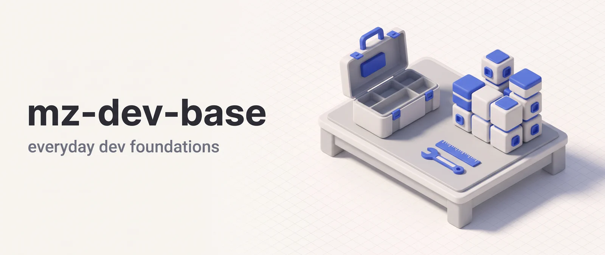

<p align="center"></p>

# mz-base

mz-base is the foundation plugin of the mozg-pipelines marketplace. It ships five agents (a code reviewer, a technical writer, two researchers and an over-engineering lens used by review and cleanup pipelines) and two skills. One drafts new skills for a plugin. The other routes a task to the right skill across the `mz-*` plugins. It's for developers who want a reviewer, a researcher or a doc writer on call, and for users of other mozg plugins, whose skills dispatch these agents.

**Works in:** Claude Code and Cowork. claude.ai chat loads skills without their agents: `/using-mozg-pipelines` dispatches none, but `/construct-skill` can dispatch a subagent, and the five agents aren't available there.

## Installation

```bash
claude plugin marketplace add DoctorMozg/claude-pipelines
claude plugin install mz-base
```

## Skills

```text
/construct-skill <skill name or intent>
/using-mozg-pipelines [task description]
```

### `/construct-skill`: Skill Authoring Helper

Drafts a new skill for a plugin in a marketplace repo, following the repo's skill guidelines. Walks you through the description, anatomy, state, approval gates and the pre-publish checklist in a RED/GREEN/REFACTOR loop. It needs a checkout that has `.claude-plugin/marketplace.json` and a `plugins/` directory. It doesn't write `.claude/skills` skills or review existing ones.

### `/using-mozg-pipelines`: Routing Map

Maps natural-language task phrases to the right skill across all `mz-*` plugins. It runs when you ask "which skill fits", "route this" or "what plugins do I have".

The `/init-rules` skill moved to the separate mz-rules plugin.

## Agents

You can invoke `code-reviewer`, `technical-writer` and `pipeline-web-researcher` directly. `pipeline-web-researcher`, `pipeline-researcher` and `code-lens-over-engineering` live here because skills in several plugins dispatch them.

| Agent                          | Purpose                                                                                                                                                                                                                 |
| ------------------------------ | ----------------------------------------------------------------------------------------------------------------------------------------------------------------------------------------------------------------------- |
| **code-reviewer**              | Reviews code changes for bugs, security vulnerabilities, performance issues, and maintainability                                                                                                                        |
| **technical-writer**           | Creates and improves technical documentation grounded in actual code                                                                                                                                                    |
| **pipeline-researcher**        | Pipeline-only. Codebase exploration and domain research for planning and review pipelines such as `/build`, `/debug`, `/audit` and the `branch-reviewer` agent                                                          |
| **pipeline-web-researcher**    | Sourced web research on a technical question, such as a version change or a tool comparison. Also dispatched by `/deep-research`, `/combine`, `/ask`, `/clean-leftovers`, `/naturalize` and the branch and PR reviewers |
| **code-lens-over-engineering** | Pipeline-only. Flags code that should not exist or should be smaller. Dispatched by branch-reviewer and the build, polish, cleanup and optimize skills                                                                  |

For local branch review (`/review-branch`) and GitHub PR workflows (`/github-review-pr`, `/github-scan-prs`) plus their lens agents and PR collectors, see [`mz-dev-git`](https://github.com/DoctorMozg/claude-pipelines/tree/master/plugins/mz-dev-git).

## Data and network

mz-base has no hooks, scripts or MCP servers, so nothing it ships runs outside your Claude Code session. Nothing is sent to the author: no telemetry, no analytics, no crash reports.

What gets written, and where:

- `/construct-skill` keeps task state (`state.md`) and a failure log (`red.md`) under `.mz/task/<task_name>/` in the project root, and appends a record of its approval gate to `.mz/journal.md`.
- `/construct-skill` writes the draft skill into `plugins/<plugin>/skills/<name>/` of your checkout before you approve it. Approve keeps the files. Reject moves the draft to `.mz/task/<task_name>/rejected_draft`, or names the directory if the move is refused. It refuses to overwrite an existing skill directory and doesn't create a plugin directory.
- `/construct-skill` runs local checks such as `claude plugin validate`, `pre-commit` and `make test`. The only shell command the skill pre-approves is `claude plugin validate`. The others follow your normal permission settings.
- `technical-writer` creates and edits documentation files in your project as part of the task you give it. It has no approval step of its own, though it asks before writing when the audience, scope or source of truth is unclear. It can run Bash to compile or run the snippets it documents.
- `code-lens-over-engineering` writes one findings file, at the path the dispatching skill gives it.
- `code-reviewer` reads your code and has Bash access. It writes a report file only when the dispatch names a path.
- `pipeline-researcher` and `pipeline-web-researcher` are read-only: no Write, Edit or Bash. They return findings in their reply, and the dispatching skill decides what to save.
- `/using-mozg-pipelines` has no write tool. It reads its routing table and asks questions.
- The `shared/` folder is plain markdown reference files that skills read.

What goes over the network:

- `pipeline-web-researcher`, `pipeline-researcher` and `technical-writer` use Claude Code's WebSearch and WebFetch tools. They search the web and fetch the pages Claude picks for your question.
- No other mz-base agent or skill has a web tool.
- As in any Claude Code session, your prompts and the files Claude reads go to the model you use, under your own account. See PRIVACY.md below.

## Support

- Issues: <https://github.com/DoctorMozg/claude-pipelines/issues>
- Email: drmozg@gmail.com
- Privacy: [PRIVACY.md](https://github.com/DoctorMozg/claude-pipelines/blob/master/PRIVACY.md) lists what stays on your machine and what each plugin sends out.

## License

MIT
