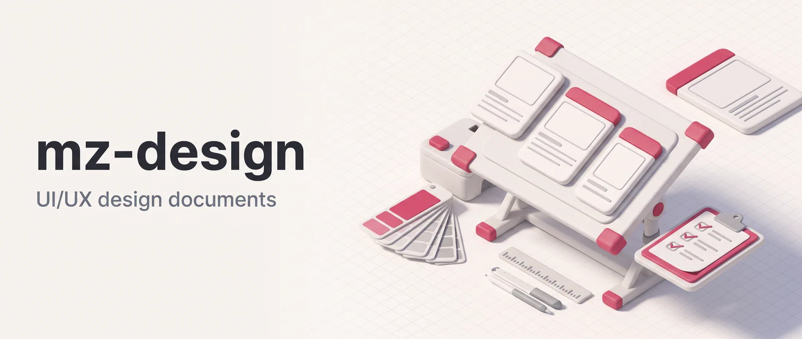

<p align="center"></p>

# mz-design

mz-design turns a UI/UX brief into a design document: ASCII wireframes, Mermaid flow diagrams and a computed WCAG contrast report. It scans your codebase for existing components and design tokens, researches the problem domain, drafts the document, then runs it past four specialist critics in parallel until all of them pass with zero WCAG AA contrast violations, for up to five rounds. It's for developers and designers who want a reviewed design document for a page, screen or flow before anyone builds it.

**Works in:** Claude Code and Cowork. claude.ai chat loads the plugin's skill but ignores its agents, so the pipeline can't run there ([component support by app](https://claude.com/docs/plugins/platform-support)).

## Installation

```bash
claude plugin marketplace add DoctorMozg/claude-pipelines
claude plugin install mz-design
```

In the Claude desktop app (Cowork), add `DoctorMozg/claude-pipelines` from Customize > Plugins with Add > Add marketplace, then add mz-design.

## Usage

```
/design-document "team admin console — settings page with sections for members, billing, integrations, and audit log"
```

Anchor the design against existing components by scoping the codebase scan:

```
/design-document scope:branch "add a design for the new notifications preferences page"
```

Modifiers go in the same message as the brief:

- `scope:branch|global|working` sets which files the researcher scans. `global` is the default and covers every file git doesn't ignore. `branch` covers files changed on the current branch, and `working` covers uncommitted changes.
- `@doc:<path>` ingests an existing requirements or brief document. The researcher reads it in full.
- `@image:<path>` records a reference image without decoding it, and the writer leaves placeholders for it.

With an empty brief the skill asks for one instead of guessing.

## Skill

| Skill               | Command                                            | Inputs                                                            | Output                                                                                      |
| ------------------- | -------------------------------------------------- | ----------------------------------------------------------------- | ------------------------------------------------------------------------------------------- |
| **design-document** | `/design-document` or `/mz-design:design-document` | Text brief, optional `@image:` refs, `scope:`, `@doc:` references | `design.md`, `wireframes.md`, `wcag-report.md`, `final-summary.md`, per-iteration critiques |

## Pipeline

```
/design-document "settings page for a team-admin console"
  │
  ├─ Phase 1: Intake & research
  │     └─ design-researcher (sonnet) — codebase + WebSearch
  ├─ Phase 2: Initial draft
  │     └─ design-document-writer (opus) — design.md + wireframes.md + wcag-report.md
  ├─ Phase 3: Critique loop (max 5 iterations)
  │     ├─ ui-designer              (opus) — layout, grid, hierarchy
  │     ├─ ux-designer              (opus) — flows, IA, Nielsen heuristics
  │     ├─ art-designer             (opus) — color theory, type pairing, mood
  │     ├─ accessibility-specialist (opus) — WCAG 2.2 AA hard gate
  │     ├─ design-critique-synthesizer (sonnet) — merges findings
  │     └─ design-revision-writer   (opus) — applies action items if any critic fails
  └─ Phase 4: Finalization
        └─ User approval gate → final-summary.md
```

`design.md` follows a fixed 14-section template: overview, user flows, information architecture, layout and grid, components, color system, typography, spacing and sizing, motion and interaction, responsive strategy, states, accessibility, design rationale, open questions. The critics work from two bundled references, Nielsen's 10 usability heuristics and the WCAG 2.2 contrast thresholds and formula.

## Agents

The skill dispatches all eight agents. They're pipeline-only and aren't meant to be called on their own.

| Agent                         | Model  | Role                                                           |
| ----------------------------- | ------ | -------------------------------------------------------------- |
| `design-researcher`           | sonnet | Codebase scan + WebSearch for domain patterns                  |
| `design-document-writer`      | opus   | Produces initial design.md, wireframes.md, wcag-report.md      |
| `design-revision-writer`      | opus   | Applies critique action items without rewriting clean sections |
| `design-critique-synthesizer` | sonnet | Merges four critic outputs into a single action plan           |
| `ui-designer`                 | opus   | Visual layout, grid systems, whitespace, hierarchy critic      |
| `ux-designer`                 | opus   | Flows, IA, interaction, Nielsen heuristics critic              |
| `art-designer`                | opus   | Color harmony, type pairing, mood, aesthetic coherence         |
| `accessibility-specialist`    | opus   | WCAG 2.2 AA validator, owns the hard gate                      |

## Exit criteria

The critique loop ends when all four critics return `VERDICT: PASS` (zero `Critical:` findings) **and** the accessibility-specialist returns `WCAG_GATE: PASS`. The accessibility-specialist recomputes every contrast ratio from scratch instead of trusting the writer's numbers. The gate fails on any of these:

- text below 4.5:1
- large text, UI components or focus indicators below 3:1
- a color pair used in the design but missing from `wcag-report.md`
- a reported ratio that disagrees with the recomputed one

If the loop still fails after 5 iterations, the orchestrator shows the open findings and asks via `AskUserQuestion`. You can accept them (they're listed in `final-summary.md`), abort, or reply with guidance for one more revision. There is no silent partial acceptance.

Unless you abort, the run ends at the approval gate. The full design, wireframes and contrast report are printed in chat. Approve writes `final-summary.md`, Reject marks the task aborted, and any other reply is feedback that triggers a revision pass without a new critique round. The skill has no unattended mode, so a run with nobody to answer stops as `blocked`.

## Output location

```
.mz/design/<YYYY_MM_DD>_design_<slug>/
├── intake.md
├── research.md
├── design.md
├── wireframes.md
├── wcag-report.md
├── iter_<N>_<critic>.md ... one per critic per round
├── critique_1.md ... critique_N.md
└── final-summary.md

.mz/task/<YYYY_MM_DD>_design_<slug>/
└── state.md
```

## Data and network

**Local.** The skill and its eight agents run inside your Claude Code or Cowork session. The researcher reads files in your project to find components, tokens, styles, icons, fonts and accessibility conventions, within the `scope:` you set. It also reads any `@doc:` files you pass, and it doesn't open image references. The plugin ships no hooks, MCP servers or scripts.

**Written files.** Everything goes under `.mz/` in the project root: the git root, or the current directory outside a git repository. `MZ_MEMORY_ROOT` overrides both. Writing starts before you approve anything:

- At setup, `.mz/task/<task_name>/state.md`.
- During research, drafting and critique, the files in `.mz/design/<task_name>/` except `final-summary.md`.
- After the approval gate, `final-summary.md` (only on Approve) and an entry in `.mz/journal.md` with the gate's outcome and the artifact it gated.

Reject leaves the earlier files in place. No step of the skill edits your source files. It produces a spec, not an implementation.

**Hooks.** None.

**Network.** Only `design-researcher` has web tools, WebSearch and WebFetch. The skill itself is also allowed WebSearch. During intake and research it looks up how design systems handle the brief's problem area (settings, billing or onboarding, for example), which WCAG criteria apply to the components involved, and known pitfalls. Its source order is official design-system docs (Material Design, Apple HIG, Fluent, Carbon, Polaris), MDN, web.dev, caniuse, W3C WCAG documentation, vendor engineering blogs and HCI papers. It fetches public documentation pages, not authenticated ones. The model writes the queries from your brief, so leave out confidential details if that matters to you.

The other seven agents have no web tools, and nothing in the plugin asks for any other network call. Your brief, the files the agents read and everything they write are processed by the Claude model in your session, under your own Anthropic account. Nothing is sent to the author: the plugin has no server, telemetry or analytics.

## Support

- Issues: https://github.com/DoctorMozg/claude-pipelines/issues
- Email: drmozg@gmail.com
- [Privacy policy](https://github.com/DoctorMozg/claude-pipelines/blob/master/PRIVACY.md)

## License

MIT. See [LICENSE](https://github.com/DoctorMozg/claude-pipelines/blob/master/LICENSE).
