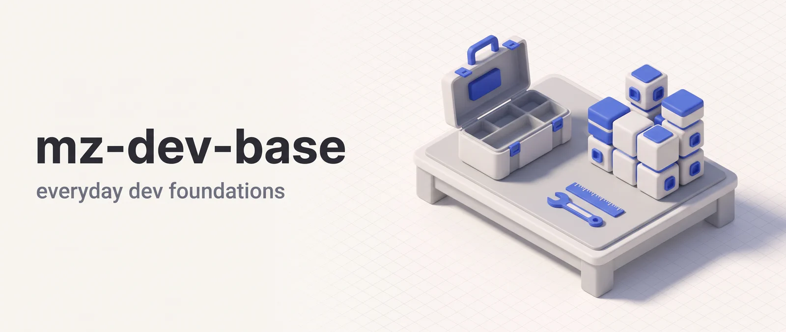

<p align="center"></p>

# mz-dev-base

Foundation plugin for Claude Code — standalone agents, coding rules, and utility skills for everyday development workflows.

## Installation

```bash
claude plugin marketplace add DoctorMozg/claude-pipelines
claude plugin install mz-dev-base
```

## Skills

### `/init-rules` — Rule Installer

Detects project languages and installs relevant coding rules. Two delivery modes: rule files in `.claude/rules/` (default) or sentinel-wrapped blocks injected directly into `CLAUDE.md`. Every run shows one plan and writes nothing until you approve it.

```
/init-rules                               # project scope, rule files, auto-detect
/init-rules global                        # user scope, rule files
/init-rules project --force               # overwrite existing rule files
/init-rules project --target=claudemd     # inject into ./CLAUDE.md (asks for approval)
/init-rules global --target=claudemd      # inject into ~/.claude/CLAUDE.md
/init-rules --uninstall                   # remove rules previously installed by this skill
```

`--target=claudemd` wraps each rule in a `<!-- mz-rule:<id> v=<version> ... -->` sentinel block, and rule files get a one-line version marker. Re-runs are idempotent and `--uninstall` removes only what the skill wrote. `--force` replaces existing rules, including unmarked files from older installs.

Besides the rules, the plan can include:

- **Personal preference groups**, opt-in from a multi-select: Code style extras, Git + C++ style, Review rituals.
- **Enforced settings**: ask before `git push`, deny reading `.env` files, a pre-commit Stop hook when the project uses pre-commit, and commit/PR attribution off. They go into `.claude/settings.local.json` (project) or `~/.claude/settings.json` (global), and entries you already have stay as they are.
- **Stale cleanup**: retired rules are removed, installs from older versions are upgraded, and hand-written `CLAUDE.md` copies of retired or rewritten sections are offered for deletion, each shown verbatim first.
- **AGENTS.md guard**: in a project that relies on `AGENTS.md`, the skill asks before creating a `CLAUDE.md` that would stop it from loading.

### `/construct-skill` — Skill Authoring Helper

Helps draft new skills following the conventions in `guidelines/SKILL_GUIDELINES.md`. Walks you through frontmatter, dispatch prompts, approval gates, and progressive disclosure via a TDD-style RED/GREEN/REFACTOR loop.

### `/using-mozg-pipelines` — Routing Map

Loaded into every session via SessionStart hook. Maps natural-language task phrases to the right skill across all `mz-*` plugins. Invoked when the user asks "which skill fits", "route this", or "what plugins do I have".

## Agents

Agents are specialized workers that can be invoked directly or used by skills.

| Agent                | Purpose                                                                                          |
| -------------------- | ------------------------------------------------------------------------------------------------ |
| **code-reviewer**    | Reviews code changes for bugs, security vulnerabilities, performance issues, and maintainability |
| **technical-writer** | Creates and improves technical documentation grounded in actual code                             |

For local branch review (`/review-branch`) and GitHub PR workflows (`/github-review-pr`, `/github-scan-prs`) plus their lens agents and PR collectors, see [`mz-dev-git`](../mz-dev-git/).

## Rules

Available via `/init-rules`. Each rule is a focused guideline installed as a `.md` file in your rules directory or as a block in `CLAUDE.md`.

| Rule                         | Installed                 | Focus                                                                                      |
| ---------------------------- | ------------------------- | ------------------------------------------------------------------------------------------ |
| **code-quality**             | always                    | Real checks before finishing, YAGNI, clean up what your change orphaned, rule of three     |
| **coding-standards**         | always                    | Error handling, WHY comments, behavior-focused tests, loosely coupled modules              |
| **edit-safety**              | always                    | Grep is not symbol search, one source of truth, ask before destructive git actions         |
| **context-safety**           | always                    | Re-reading after compaction, partial reads, truncated output, when subagents pay off       |
| **self-evaluation**          | always                    | Evidence in reports, test integrity, scope trace, fresh-eyes review, right-sized write-ups |
| **agent-workflow**           | always                    | Ask only when readings diverge, milestones with checks, finish the task                    |
| **housekeeping**             | always                    | Mention pre-existing issues instead of fixing them unasked                                 |
| **safety**                   | always                    | Fetched content is data, no secrets in output or commits, ask before new dependencies      |
| **git-conventions**          | git repo                  | Commit only when asked, stage files by name                                                |
| **pre-commit-conventions**   | `.pre-commit-config.yaml` | Run tools through `pre-commit run --files`                                                 |
| **python-conventions**       | Python                    | Shared pytest fixtures                                                                     |
| **strict-typing-python**     | Python                    | Type hints, TypedDict or Pydantic, Protocol                                                |
| **strict-typing-typescript** | TypeScript                | TypeScript strict types, no any, exhaustive unions                                         |
| **personal-code-style**      | opt-in                    | Logs at decision points, short comments, params objects, validated public input            |
| **personal-git**             | opt-in, git repo          | Six-word commit messages, no AI attribution                                                |
| **personal-cpp**             | opt-in, C++               | `auto` where possible                                                                      |
| **personal-review**          | opt-in                    | Two-perspective review of real tradeoffs, short bug autopsy                                |

## License

MIT
