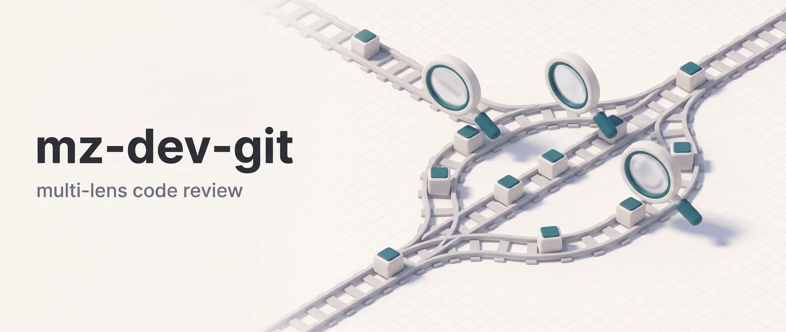

<p align="center"></p>

# mz-dev-git

mz-dev-git adds three skills to Claude Code: a deep review of your local branch, a deep review of a GitHub pull request, and a ranked triage of the PRs that need your attention. Each review fans out to six parallel lenses (bugs, security, architecture, performance, maintainability, over-engineering) plus a blind adversarial pass, and ends in a severity-labeled report with a pass/fail verdict. It's for developers who want a thorough read before they push, and for reviewers who juggle PRs across several repositories.

**Works in:** Claude Code and Cowork. The skills dispatch agents, and claude.ai chat loads skills without their agents, so the pipelines don't run there.

## Installation

```bash
claude plugin marketplace add DoctorMozg/claude-pipelines
claude plugin install mz-dev-git
```

Installing `mz-dev-git` also installs [mz-base](https://github.com/DoctorMozg/claude-pipelines/tree/master/plugins/mz-base), its dependency. Disabling `mz-base` disables `mz-dev-git`.

## Requirements

- `git` for the two review skills.
- For the GitHub skills, one of: the `gh` CLI authenticated, a GitHub MCP server in the session, or `$GITHUB_TOKEN` set. The agents try them in that order.
- `/github-review-pr` must run inside a clone of the PR's repository, meaning one with a remote that names `owner/repo`. Otherwise the agent stops and asks you to run it from one.

## Skills

Plugin skills are also available under their namespaced names, such as `/mz-dev-git:review-branch`.

### `/review-branch`: branch review

Reviews every change on the current branch against a base branch (default `main`). It stops if you're on `main` or `master`, since there is nothing to diff.

```text
/review-branch              # compare against main
/review-branch develop      # compare against develop
```

`branch-reviewer` walks each changed file and runs six lenses in parallel with full repo context. It then runs a blind audit: three adversarial researchers (production reliability, security, ops/SRE) see only the raw diff and surface "Blind Spots" the first wave missed. A branch in an unfamiliar domain also gets a web research pass. The report is saved to `.mz/reviews/`.

**Pipeline**: branch-info-collector gathers git metadata and prior review reports. Optional web research comes next, then 6 code-lens agents in parallel, then 3 blinded researchers, and finally the consolidated report.

### `/github-review-pr`: pull request review

Reviews a GitHub PR given as a URL or `owner/repo#number`. It reads the metadata, diff, review threads and comments, checks the code out in a temporary worktree, and runs the same analysis as `/review-branch` there.

```text
/github-review-pr https://github.com/owner/repo/pull/123
/github-review-pr owner/repo#123
```

Findings are cross-referenced with what reviewers and bots such as Copilot and CodeQL already said. Each one lands under New Issues or Previously Reported (Still Open, Addressed With Reply, Resolved Silently, Outdated). Threads marked resolved without a reply are re-checked against the code.

The review is skipped, with the reason written to the report, when the PR is closed, merged, a draft, empty, authored by you (unless you ask explicitly), or already approved by you.

**Pipeline**: github-pr-reviewer gathers the PR data, builds the map of existing concerns and sets up the worktree. branch-reviewer then fans out on the worktree, the findings are cross-referenced, and the report carries the verdict and Critical-finding count.

### `/github-scan-prs`: PR triage

Scans GitHub repositories for PRs that need your attention: review requested, mentioned, assigned, or your own PRs with changes requested. It scores every PR it finds and ranks them into three tiers. Tier 1 is directly asked and unanswered, Tier 2 is review or action requested, Tier 3 is informational. Within a tier, complexity and age set the order.

```text
/github-scan-prs                              # current repo only
/github-scan-prs owner/repo1, owner/repo2     # explicit list
```

The scan reads metadata and counts, never diff content, and doesn't review code. For any PR in the report, run `/github-review-pr` separately.

**Pipeline**: github-pr-scanner dispatches github-pr-data-fetcher (multi-repo PR list, dedup, zero-result smoke tests), then one github-pr-info-scorer per PR (haiku, parallel waves of up to 6), and writes the tier-ranked report to `.mz/reviews/`.

## Reading the report

Every finding carries one label: `Critical:`, `Nit:`, `Optional:` or `FYI:`. A new finding becomes `Critical:` only when its confidence is 80 or higher and two independent signals agree, either two lenses or a lens plus a matching blind-audit finding. Findings that only the blind audit raised are capped at `Optional:` or `FYI:` and listed under Blind Spots.

The verdict line is `VERDICT: PASS` when there are no `Critical:` findings, `VERDICT: FAIL` otherwise.

## Agents

The skills dispatch these agents. Claude can also pick up the three orchestrators directly, since their descriptions say when to use them. The rest are pipeline-only and never user-triggered.

| Agent                         | Model  | Role                                                                                             |
| ----------------------------- | ------ | ------------------------------------------------------------------------------------------------ |
| **branch-reviewer**           | opus   | Top-level orchestrator. Walks each changed file, fans out 6 code-lens agents, merges findings    |
| **branch-info-collector**     | haiku  | Pipeline collector: runs git metadata commands and scans for prior review reports                |
| **github-pr-reviewer**        | opus   | Top-level PR orchestrator. Sets up a temp PR worktree, dispatches branch-reviewer, writes report |
| **github-pr-scanner**         | sonnet | Multi-repo PR triage orchestrator. Fans out github-pr-info-scorer per PR, produces tier ranking  |
| **github-pr-data-fetcher**    | haiku  | Pipeline collector: bulk PR list, dedup and zero-result smoke tests across multiple repos        |
| **github-pr-info-scorer**     | haiku  | Per-PR scorer: lightweight metadata, complexity and answered/unanswered classification           |
| **code-lens-bugs**            | sonnet | Pipeline lens: logic errors, off-by-one, null access, races, resource leaks                      |
| **code-lens-security**        | sonnet | Pipeline lens: injection, auth bypass, secret exposure, SSRF, IDOR, weak crypto                  |
| **code-lens-architecture**    | sonnet | Pipeline lens: SOLID violations, coupling, layering, pattern drift, god classes                  |
| **code-lens-performance**     | sonnet | Pipeline lens: N+1, blocking I/O in async, missing indexes, O(n²) hot paths                      |
| **code-lens-maintainability** | sonnet | Pipeline lens: unclear naming, complexity, magic values, dead code, duplication                  |

## Cross-plugin dispatch

`branch-reviewer` dispatches `pipeline-web-researcher`, `pipeline-researcher` and `code-lens-over-engineering`. `github-pr-reviewer` dispatches `pipeline-web-researcher`. Those three agents live in `mz-base` because skills in other plugins dispatch them too. Claude Code resolves agent names across all loaded plugins, and the manifest declares `mz-base` as a dependency, so it installs with `mz-dev-git`.

## Data and network

The plugin runs inside your Claude session and has no server of its own. As in any session, the code and PR text Claude reads goes to the model you use there. Beyond that:

- **`/review-branch` works on local git only.** It reads branch metadata, the diff against the base and the changed files. It makes no GitHub calls and never fetches or pushes. Its only outside access is the web research below.
- **`/github-review-pr` fetches the PR head and the base branch from your git remote** and checks the PR out into a temporary worktree at `<project>/.claude/worktrees/pr-<number>-<random>`, inside your project. The checkout is detached, so no local branch is created or moved. `github-pr-reviewer` removes the worktree (`git worktree remove --force`, then `git worktree prune`) before it returns, including when it stops with an error. After the agent returns, the skill removes any `pr-<number>-*` worktree left behind by a crash or turn limit. Reports are never written into the worktree.
- **GitHub access.** `/github-scan-prs`, `/github-review-pr` and their agents query GitHub with `gh`. If a `gh` call fails, they try a GitHub MCP server in your session, then the REST API with `$GITHUB_TOKEN` from your environment. The token goes only to `https://api.github.com`.
  - The scan reads your login, the PRs in the repos you name that match review-requested, assigned, mentioned or authored by you, and per PR the title, author, labels, dates, draft flag, review decision, file paths, line counts, reviews and comment text. It does not read diff content.
  - The review reads your login, the PR title, description, labels and state, the full diff, reviews, inline and issue comments, review-thread resolution state, and the title and state of issues the PR links with `Fixes #N` or `Closes #N`.
- **No agent writes to GitHub.** Nothing in the agent or skill files posts a comment, submits a review, applies a label or changes a PR. The `curl` fallback sends plain GET requests, the one GraphQL call is a read query, and results go only to local reports. The agents' MCP access is a `mcp__github__*` wildcard, so the allowlist doesn't itself block a write tool. No prompt calls one.
- **Web research uses Claude Code's WebSearch and WebFetch.** `branch-reviewer` and `github-pr-reviewer` have both tools. They use them, directly or through mz-base's `pipeline-web-researcher`, when the change touches an unfamiliar domain. The three blinded researchers (mz-base's `pipeline-researcher`, dispatched on every review) have the same tools. Claude picks the queries and pages. The prompts steer agents toward official docs and away from Stack Overflow, forums and undated blogs, which is guidance rather than a network filter. The scan agents, the collector and the five code-lens agents have no web tools.
- **Reports and state stay in your project.** Reports go to `.mz/reviews/`, task state and working files to `.mz/task/<task_name>/`. The working files include a copy of the branch diff. The plugin ships no hooks and no telemetry, and nothing is sent to the author.

## Support

- Issues: https://github.com/DoctorMozg/claude-pipelines/issues
- Email: drmozg@gmail.com
- Privacy: [PRIVACY.md](https://github.com/DoctorMozg/claude-pipelines/blob/master/PRIVACY.md)

## License

MIT
