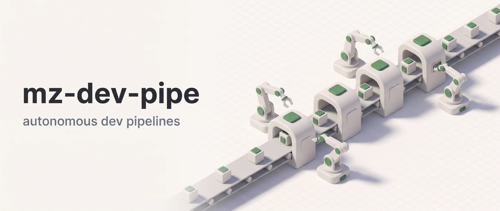

<p align="center"></p>

# Mozg Dev Pipelines (`mz-dev-pipe`)

Six skills that run multi-agent development workflows in your repository. They build a feature test-first, fix a bug, bring code up to stated criteria (passing tests, a refactor, or a sweep for AI-generated leftovers), optimize against a benchmark, audit, or answer a question about the code. Each skill splits the work across specialist agents (researchers, planners, coders, reviewers, test writers) and stops at approval gates for your sign-off. It's for developers who want an agent team to carry a well-defined task through research, implementation, review and testing, with the plan or diff in front of them before any edit starts.

**Works in:** Claude Code and Cowork. claude.ai chat loads the skills but not the agents they rely on.

## Installation

```bash
claude plugin marketplace add DoctorMozg/claude-pipelines
claude plugin install mz-dev-pipe
```

The install also pulls in [`mz-base`](https://github.com/DoctorMozg/claude-pipelines/tree/master/plugins/mz-base), its dependency, which supplies the researcher and review agents these skills dispatch.

## Pick a skill in 5 seconds

| You want to                                       | Run                                                          |
| ------------------------------------------------- | ------------------------------------------------------------ |
| Fix a known bug                                   | `/debug`                                                     |
| Investigate a suspected bug (no fix)              | `/debug certainty:low`                                       |
| Build a new feature end-to-end                    | `/build`                                                     |
| Sweep code for problems before a PR (report only) | `/audit` (or `/audit depth:deep` for ship)                   |
| Iterate fix-test-review until clean               | `/polish`                                                    |
| Clean up / refactor existing code                 | `/polish clean up <scope>, behavior unchanged`               |
| Strip AI comments, signatures and phase markers   | `/polish no AI leftovers in <scope>`                         |
| Make something measurably faster or smaller       | `/optimize`                                                  |
| Get a researched answer to a question             | `/ask`                                                       |
| See what breaks if you change X                   | `/audit depth:deep scope:branch` (auto-invokes blast-radius) |
| Understand existing code                          | `/explain` (now in `mz-research-pipe`)                       |
| Research a topic across the web                   | `/deep-research` (now in `mz-research-pipe`)                 |
| Synthesize prior pipeline output into one doc     | `/combine` (now in `mz-research-pipe`)                       |
| Translate files preserving structure              | `/translate` (now in `mz-research-pipe`)                     |

## Skills

### `/build`: Test-First Development Pipeline

Researches the codebase and writes a parallelizable plan. After you approve it, the pipeline writes failing tests, dispatches coder agents to make them pass without editing the tests, reviews the code, refactors, and checks completeness.

```
/build implement OAuth2 PKCE flow for the auth module
/build add rate limiting middleware with Redis backing
```

**Pipeline**: Research, Plan, Plan Review, Approval Gate, Tests (RED), Test Review, Verify RED, Parallel Implementation (GREEN), Code Review, Lint & Verify GREEN, Final Review, Refactor, Completeness Check

### `/audit`: Multi-Lens Codebase Audit

Report-only. Scans code through five independent lenses (correctness, security, performance, maintainability, reliability) and ranks the findings by severity. It never edits code. Pass the report to `/build`, `/debug` or `/polish` to act on it. With a bounded scope (`branch`, `working` or a path list) it also inspects files downstream of the change.

```
/audit                                    # full roam — scan everything
/audit security review                    # single lens
/audit src/auth/                          # narrow scope, all lenses
/audit scope:branch concurrency bugs      # branch files, specific lens
/audit depth:deep                         # pre-PR pass, branch scope by default
```

**Pipeline**: Scope, 1-5 Parallel Researchers, Consolidate & Rank, Final Report

**Severity caps** (standard depth): all critical, top 10 high, top 5 medium. Findings over a cap, and all low findings, go to `findings_capped.md`.

**`depth:deep`** adds blast-radius tiering, evidence-tiered severity caps, three blinded adversarial lenses, a rollback rehearsal, and a ledger of blocking findings at `.mz/reports/audit_ledger.md`.

### `/debug`: Reactive Bug Investigation & Hypothesis Verification

Two modes, selected by the `certainty:` parameter.

**`certainty:high` (default, TDD bug fix)**: Given a bug report (error message, stack trace, failing test, or description), it reproduces the bug, diagnoses the root cause with optional domain research, writes a regression test before the fix (TDD), applies a minimal fix, and verifies.

```
/debug "KeyError: 'user_id' in process_payment"
/debug test_auth_refresh fails
/debug https://github.com/owner/repo/issues/42
/debug scope:branch the WebSocket reconnection fails on timeout
```

**Pipeline**: Reproduce, Diagnose (+ Domain Research), Approval Gate, Regression Test (must fail), Fix (test passes), Verify & Review, Report

**`certainty:low` (hypothesis investigation, no fix)**: Takes a suspected issue or behavioral question, analyzes the code for evidence, runs domain research when complex external behavior is involved, writes exploratory tests to prove or disprove it, and reports a verdict. **No code fixes**: the output is a report. The exploratory tests do land in your test files. Passing tests stay, failing ones are kept marked as expected failures, and tests that error are removed.

```
/debug certainty:low the caching layer might not invalidate on concurrent writes
/debug certainty:low does the retry logic actually back off exponentially?
/debug certainty:low scope:branch the auth middleware might not handle expired refresh tokens
```

**Pipeline**: Code Analysis, Domain Research (conditional), Exploratory Tests, Verdict Report (no approval gate)

**Verdicts**: confirmed, disproved, inconclusive, partially confirmed. If confirmed, the report suggests running `/debug` (high certainty, the default) to fix it.

**Accepts**: free text, hypotheses, failing test names, stack traces, error messages, GitHub issue URLs.

### `/ask`: Researched Question Answering

Answers a question by researching the codebase and, when the question involves an external library, API, or concept, the web. Classifies the question, dispatches researcher agents in parallel, and synthesizes a direct, sourced answer. Read-only, so it never modifies code.

```
/ask how does the auth middleware refresh tokens
/ask why does the build use esbuild instead of webpack
/ask does this repo support multi-tenant auth
```

**Pipeline**: Setup & Classification, Codebase Research, Web Research (conditional), Synthesis & Answer

**Not for** diagram-rich code walkthroughs (use `/explain`) or testable hypotheses (use `/debug certainty:low`).

### `/polish`: Iterative Code Polisher

Takes existing code and iterates fix-test-review cycles until specific completion criteria are met. Unlike `/build`, which builds from scratch, `/polish` works with what's already there. When a behavioral criterion has no test, it writes the test first and confirms it fails before fixing.

Two kinds of criteria need no failing check:

- **Cleanup** ("clean up src/auth/, behavior unchanged"): removes dead code, unused imports, duplication and needless complexity from a scope.
- **Residue** ("no AI leftovers in this branch"): removes AI signatures, pipeline phase markers, planning comments, comments and docstrings that restate the code, and uncalled stubs. It keeps license headers, tool directives and comments that explain why.

A scope over 12 files is split by directory into up to 6 chunks, each with its own optimizer and reviewer. Tests must stay green throughout, and a cleanup criterion also gets a blast-radius check at the approval gate.

```
/polish all tests pass and pre-commit is clean
/polish scope:branch fix all failing tests and clean up the implementation
/polish the WebSocket reconnection must handle timeout correctly
/polish clean up src/auth/, behavior unchanged
/polish scope:branch no AI leftovers
```

**Pipeline**: Assessment, Approval Gate, Quick Fixes, Research (if needed), Fix-Test-Review Loop (max 5 iterations), Optimization & Cleanup (chunked for large scopes), Final Verification

### `/optimize`: Measure-First Performance Optimization

Makes a target faster, smaller, or cheaper against a goal that a command can measure. It establishes a baseline, profiles the dominant bottleneck, forms falsifiable hypotheses, builds candidate changes in isolated git worktrees, and keeps a change only if a benchmark proves it faster and a correctness check proves it safe. Every speedup number comes from the measurement harness (`pipeline-measure-runner`), never from model narration.

The same loop works on source code, container images, LLM hyperparameters, build pipelines, or a composite system. A per-run Optimization Contract defines the target, metric, measurement and correctness commands, and allowed changes. You approve it before anything is measured.

```
/optimize make src/parser/tokenizer.py 2x faster, p95 under 120ms
/optimize type:container reduce the api image below 200MB
/optimize type:system scope:branch cut orchestrator end-to-end latency below 400ms
```

**Pipeline**: Goal Declaration, Contract Approval, Baseline, Profile & Classify, Hypothesize, Strategy Approval, Candidate Generation & Verification, Validation (sign-off gate), Terminate (re-profile loop or stop)

**Not for** removing dead code or reducing complexity (use `/polish` with a cleanup criterion).

### `/combine`, `/deep-research`, `/explain`, `/translate`: moved to `mz-research-pipe`

These research and content skills now live in the [`mz-research-pipe`](https://github.com/DoctorMozg/claude-pipelines/tree/master/plugins/mz-research-pipe) plugin, which declares `mz-dev-pipe` as a dependency.

### `/verify`, `/cleanup`, `/decomment`, `/clean-leftovers`: removed in 0.55.0

These four skills are gone, with no aliases. What to use instead:

| Removed            | Use instead                                                                                     |
| ------------------ | ----------------------------------------------------------------------------------------------- |
| `/cleanup <scope>` | `/polish clean up <scope>, behavior unchanged`                                                  |
| `/decomment`       | `/polish no AI leftovers in <scope>`                                                            |
| `/clean-leftovers` | `/polish no AI leftovers in <scope>`; `/build` and `/polish` also clean the files they change   |
| `/verify`          | Run your test, lint and type-check commands directly, or `/polish` when you want failures fixed |

## Scope parameter

Every skill except `/ask` accepts an optional `scope:` parameter:

| Mode            | What it includes                                                                                         |
| --------------- | -------------------------------------------------------------------------------------------------------- |
| `scope:branch`  | Files changed on this branch vs base                                                                     |
| `scope:global`  | Every file git doesn't ignore, minus vendored and generated files, lock files and files over 5,000 lines |
| `scope:working` | Uncommitted changes (staged + unstaged + untracked)                                                      |

For skills that edit, scope limits which files can change. Researchers, tests and linters still read the whole project. `/audit` uses it to choose which files to analyze. Each skill has its own default; `/build` uses `global`.

## Agents

Specialized worker agents used by the pipeline skills. You don't invoke these directly: the skills orchestrate them.

| Agent                             | Role                                                                                                        |
| --------------------------------- | ----------------------------------------------------------------------------------------------------------- |
| **pipeline-planner**              | Creates parallelizable implementation plans                                                                 |
| **pipeline-plan-reviewer**        | Validates plans for completeness and correctness                                                            |
| **pipeline-coder**                | Implements specific work units from an approved plan                                                        |
| **pipeline-code-reviewer**        | Reviews code for bugs, security, conventions                                                                |
| **pipeline-test-writer**          | Writes unit, edge case, and integration tests                                                               |
| **pipeline-test-reviewer**        | Unified test review: coverage gaps and test quality (assertions, independence, fragility)                   |
| **pipeline-optimizer**            | Removes dead code and AI residue, simplifies logic, cleans artifacts                                        |
| **pipeline-completeness-checker** | Final quality gate: verifies 100% task completion                                                           |
| **pipeline-measure-runner**       | Runs a benchmark with warmup and N reps and computes mean/median/CV, the only source of measurement numbers |
| **pipeline-perf-candidate**       | Implements one optimization hypothesis as a diversified candidate change in an isolated worktree            |
| **pipeline-tooling-detector**     | Finds the test, lint, format and type-check commands from project instructions, the cache, or manifests     |
| **pipeline-test-runner**          | Runs the test suite or a subset and writes parsed per-test results                                          |
| **pipeline-lint-runner**          | Runs lint and format commands and writes per-file issues                                                    |

The pipeline skills also dispatch three agents from [`mz-base`](https://github.com/DoctorMozg/claude-pipelines/tree/master/plugins/mz-base): `pipeline-researcher`, `pipeline-web-researcher` and `code-lens-over-engineering`. They live there because skills in other plugins dispatch them too.

## Architecture

Skills share one layout:

1. **SKILL.md**: slim orchestrator with setup, approval gates, and phase routing
1. **phases/\*.md**: on-demand phase files loaded only when needed (progressive disclosure)
1. **Agents**: stateless workers dispatched in parallel where safe, sequential where necessary

State is persisted to `.mz/task/<task_name>/` so pipelines can be inspected or resumed. Reports go to `.mz/reports/`.

## Data and network

Everything runs inside your Claude Code or Cowork session. The plugin has no server and no telemetry, and nothing is sent to the author. As with any Claude Code work, the files agents read go to the model you've configured, under your own account.

**Edits to your code.** `/build`, `/debug`, `/polish` and `/optimize` change files in your project. Each stops at an approval gate before its first edit: the plan (`/build`), the diagnosis (`/debug`), the assessment (`/polish`, which lists every file a cleanup or residue criterion covers), and the contract and strategy (`/optimize`). Two exceptions:

- `/debug certainty:low` has no gate and adds exploratory tests to your test files.
- `/optimize` applies each winning change to your working tree, uncommitted, before the final sign-off gate. Rejecting reverts it.

`/audit` and `/ask` don't edit your code. A missing answer at a gate is never approval, so the run stops. Setting `MZ_DEV_PIPE_AUTO_APPROVE=1` in the environment (meant for CI) skips the approve/reject prompt: the plan is still printed, and each skipped gate is logged as auto-approved. Gates that ask you to choose between more options still stop the run.

**Your project's commands.** The pipelines run your own test, lint, format and type-check commands through Bash. The commands come from your project instructions or your manifests. `/debug` runs your tests to reproduce a bug. `/optimize` runs the measurement and correctness commands from its contract, which you see at the contract gate before any of them runs. For container and build-pipeline targets, that can include your build. The skills pre-approve only fixed commands such as `git diff`, `mkdir` and the plugin's own journal script, so Claude Code asks before running each of your commands unless your permission settings allow it. A `claude -p` run has nobody to answer, so pass them in `--allowedTools`, for example `--allowedTools "Bash(npm test *)"`.

**Git worktrees.** `/optimize` builds each candidate in a temporary git worktree, so your branch, HEAD and index stay untouched. Candidates start from a snapshot commit of your working tree, held by a ref under `refs/mz/optimize/<task_name>/`. Worktrees, their branches and that ref are deleted after each round and on every exit. Winning patches stay in `.mz/task/<task_name>/patches/`.

**GitHub, read only.** `/debug` fetches an issue and `/ask` an issue or pull request when you pass a URL. Both try `gh` first (`gh issue view`, or `gh pr view` for a pull request), then a GitHub MCP server. If both fail, the skill asks you to paste the content. No skill reads a token itself. Nothing in the plugin writes to GitHub: no comments, pull requests or pushes. Fetched text reaches agents wrapped in `<untrusted-content>` markers, so instructions inside it are treated as data.

**Web research.** Research uses Claude Code's WebSearch and WebFetch tools. The agents that hold them are `pipeline-researcher` and `pipeline-web-researcher` from `mz-base`. None of this plugin's own agents has web tools. Web research happens in `/ask` (external questions), `/build` (feasibility and domain research), `/debug` (domain research), `/polish` (to check non-trivial fixes) and `/optimize` (unfamiliar domains). The agents choose the queries and pages from your task, question or bug report. Every skill also lists WebSearch and WebFetch among its allowed tools.

**Local files.** Task state, working artifacts and reports are plain files under `.mz/` in your project root (the git root, or `MZ_MEMORY_ROOT` when set): `.mz/task/<task_name>/` for each run, `.mz/reports/` for reports and the audit ledger, and `.mz/journal.md`, where gate decisions may be appended. Nothing uploads them.

## Support

Open an issue at <https://github.com/DoctorMozg/claude-pipelines/issues> or email drmozg@gmail.com. The full privacy statement is in [PRIVACY.md](https://github.com/DoctorMozg/claude-pipelines/blob/master/PRIVACY.md).

## License

MIT
