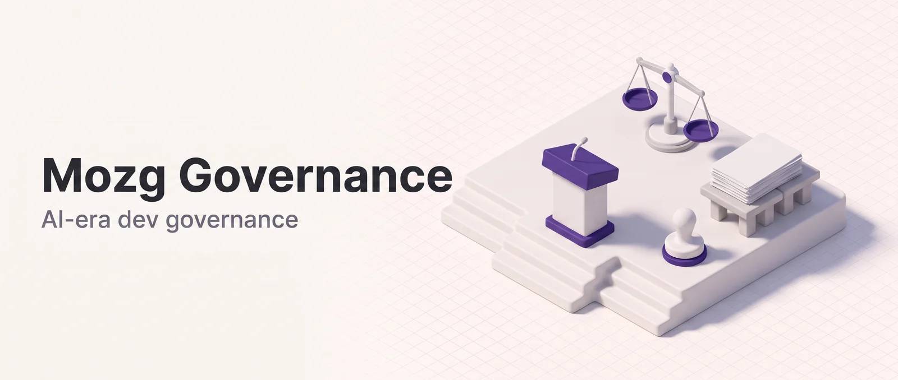

<p align="center"></p>

# Mozg Governance (`mz-gov`)

mz-gov turns a substantial design decision into a reviewed, durable record: an ADR, RFD or design doc in `docs/`, with an AI-provenance block and a human's recorded sign-off. It's for solo developers and small teams building with AI coding agents who want the reasoning behind agent-proposed changes written down and approved by a person. `/govern` routes the decision to the right artifact and pressure-tests it with a critic panel before asking for sign-off. `/gov-init` installs a CLAUDE.md policy that tells Claude to run `/govern` on its own, and `/gov-review` audits the records you already have.

**Works in:** Claude Code and Cowork. `govern` and `gov-review` dispatch agents, which claude.ai chat doesn't load. `gov-init` dispatches none but edits `CLAUDE.md` on disk, so run it in Claude Code.

## Installation

```bash
claude plugin marketplace add DoctorMozg/claude-pipelines
claude plugin install mz-gov
```

## How it works

An agent **proposes** a decision, a human **approves** it. Every governed decision carries machine-readable provenance (agent, model, timestamp, trigger) and a recorded sign-off, which closes the rubber-stamp gap that AI-authored changes are prone to.

`govern` routes a decision to an ADR, RFC/RFD or design doc, or tells you none is needed. A routine change, such as a behavior-preserving refactor, stops after routing with a one-line exemption note. Anything else is critiqued, gated behind a human sign-off, and then written to `docs/`.

`gov-init` installs a concise governance policy into your `CLAUDE.md` so the pipeline fires on the decisions that matter. `gov-review` scores existing artifacts against a six-axis completeness rubric and never edits them.

## Skills

| Skill          | Command       | Inputs                                                                    | Output                                                          |
| -------------- | ------------- | ------------------------------------------------------------------------- | --------------------------------------------------------------- |
| **govern**     | `/govern`     | A decision/change to govern, optional `artifact:adr\|rfd\|design`, `rich` | A numbered artifact in `docs/` with provenance + human sign-off |
| **gov-init**   | `/gov-init`   | `[project\|global] [--force] [--uninstall]`                               | A sentinel-wrapped governance policy block in `CLAUDE.md`       |
| **gov-review** | `/gov-review` | `[path-or-glob]`                                                          | A rubric-scored audit report in `.mz/reviews/`                  |

## The govern pipeline

```
/govern "switch the session store from in-memory to Redis"
  │
  ├─ Phase 0: Setup + AI-provenance capture
  │     └─ gov-provenance-recorder (haiku) — provenance.md, human_signoff: pending
  ├─ Phase 1: Propose
  │     └─ gov-router (sonnet) — is an artifact required? which one?
  ├─ Phase 2: Discuss  (scaled by decision weight, max 3 iterations)
  │     ├─ heavy → alternatives / reversibility / blast-radius / assumptions (opus, parallel)
  │     │          └─ gov-discussion-synthesizer (sonnet)
  │     └─ light → gov-critic-quick (sonnet, single pass)
  ├─ Phase 3: Decide
  │     └─ human sign-off gate (verbatim artifact + provenance)
  ├─ Phase 4: Record
  │     └─ gov-artifact-writer (sonnet) — docs/decisions|rfcs|design/NNNN-*.md
  └─ Phase 5: Enforce
        └─ link to commit/PR, advance status where warranted, recommend /build
```

Heavy means an RFD, a design doc, or an ADR weighing three or more options. Phase 5 only recommends the next skill and never runs it.

## Artifacts and where they live

| Artifact                      | Location                        | When                                     |
| ----------------------------- | ------------------------------- | ---------------------------------------- |
| ADR (Nygard or MADR)          | `docs/decisions/NNNN-title.md`  | A decision is made: record the why       |
| RFC / RFD (Oxide lifecycle)   | `docs/rfcs/NNNN-title.md`       | A decision is open: structure the debate |
| Design doc (Google 5-section) | `docs/design/NNNN-title.md`     | A decision is made: specify the build    |
| AI-provenance (AgDR)          | embedded in the artifact header | Every governed decision                  |

The plugin writes durable artifacts to `docs/` and leaves committing them to you. Transient pipeline state lives under `.mz/task/`.

## Agents

All agents are pipeline-only: the skills dispatch them, and you don't call them directly.

| Agent                        | Model  | Role                                                          |
| ---------------------------- | ------ | ------------------------------------------------------------- |
| `gov-router`                 | sonnet | Decides whether an artifact is required, and which            |
| `gov-provenance-recorder`    | haiku  | Formats the AI-provenance block                               |
| `gov-critic-alternatives`    | opus   | Are the considered options complete? Is the choice justified? |
| `gov-critic-reversibility`   | opus   | One-way or two-way door? Is irreversibility warranted?        |
| `gov-critic-blast-radius`    | opus   | What does this affect downstream?                             |
| `gov-critic-assumptions`     | opus   | What unstated assumptions does this rest on?                  |
| `gov-critic-quick`           | sonnet | All four lenses in one pass, for lightweight decisions        |
| `gov-discussion-synthesizer` | sonnet | Merges the critic panel into one verdict                      |
| `gov-artifact-writer`        | sonnet | Writes the numbered durable artifact to `docs/`               |
| `gov-audit-reviewer`         | opus   | Scores existing artifacts against the review rubric           |

## Usage

Govern a decision. The router picks the artifact type. Add `artifact:adr`, `artifact:rfd` or `artifact:design` to force one, and `rich` for the MADR variant of an ADR:

```
/govern "adopt optimistic locking for the inventory table"
/govern "move session storage to Redis" artifact:rfd
```

Install the governance policy so Claude invokes the pipeline on substantial decisions. `project` is the default, and `global` targets `~/.claude/CLAUDE.md`:

```
/gov-init project
```

Audit your existing decision records. With no argument, `/gov-review` checks `docs/decisions`, `docs/rfcs` and `docs/design`:

```
/gov-review docs/decisions
```

## Data and network

**Decision records and provenance.** `govern` writes to your project's `docs/` only after you approve. Phase 3 shows the full draft, the panel verdict and the provenance block, then asks for Approve or Reject. Approve stamps `human_signoff: <user>@<ISO-8601>` and unlocks `gov-artifact-writer`. Reject writes nothing to `docs/`. There's no auto-approve mode, so an unattended run waits at the gate. Before sign-off, the draft, routing, critic reviews and `provenance.md` (still `human_signoff: pending`) exist only as scratch files under `.mz/task/`. After sign-off, the record is written to `docs/decisions/`, `docs/rfcs/` or `docs/design/` with the provenance fence in its header, and Phase 5 appends a `## Provenance / Links` section to it.

**CLAUDE.md.** After you approve, `gov-init` writes one block into `./CLAUDE.md` (project scope, the default) or `~/.claude/CLAUDE.md` (global scope). The block sits between `<!-- mz-gov:governance-policy v=<version> start -->` and `<!-- mz-gov:governance-policy end -->` comments, and you see the exact text first. Reject, or no answer, writes nothing. The block is an instruction to Claude: in later sessions that load the file, Claude is told to run `/govern` itself before it builds a substantial, ambiguous design decision into code. `/govern` still stops at the sign-off gate. Global scope puts the instruction in your user-level file, so it applies to every project.

To remove it, run `/gov-init project --uninstall` or `/gov-init global --uninstall`, matching where you installed it. Removal asks for approval too, deletes the block and one adjacent blank line, and never deletes `CLAUDE.md` itself. Re-running without `--force` changes nothing. With `--force`, only the text between the sentinels is replaced.

**GitHub.** Only `govern` touches GitHub, in Phase 5, to find the open PR for the current branch so its URL can go into the artifact. `skills/govern/phases/enforce.md` tries two routes in order: first `gh pr view --json number,url,title`, then a GitHub MCP server if the session has one. The lookup names the repository owner, repository and branch, and no skill reads a token itself. All of it is read-only. The plugin never opens, edits or comments on a PR, and never pushes or commits. If every route fails, or the directory isn't a git repository, the artifact records that no PR was found.

**Local state, hooks and the author.** Task state and scratch files are plain files under `.mz/` at the project root: `.mz/task/<task_name>/` for each run, `.mz/reviews/` for `gov-review` reports, and a `decision` entry appended to `.mz/journal.md` when a decision is recorded. mz-gov ships no hooks. No skill or agent here calls a web search or fetch tool, and nothing is sent to the author. As in any Claude Code session, your prompts and the files Claude reads go to the model you use. [PRIVACY.md](https://github.com/DoctorMozg/claude-pipelines/blob/master/PRIVACY.md) covers the details.

## Support

- Issues: https://github.com/DoctorMozg/claude-pipelines/issues
- Email: drmozg@gmail.com
- Privacy: https://github.com/DoctorMozg/claude-pipelines/blob/master/PRIVACY.md

## License

MIT
