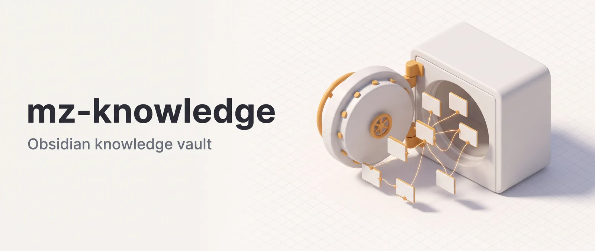

<p align="center"></p>

# Mozg Obsidian Vault (`mz-knowledge`)

mz-knowledge manages a personal Obsidian vault from Claude Code. It scaffolds a PARA + Zettelkasten structure, captures voice memos, screenshots, PDFs and YouTube videos as fleeting notes, splits captures into atomic permanent notes, triages the inbox, suggests wikilinks, audits the vault and answers questions from your notes with citations. It's for Zettelkasten-style vault owners who want Claude to do the routine upkeep. The vault workflows wait for your approval before they change notes, but two small hooks run on their own (see Data and network).

**Works in:** Claude Code and Cowork. claude.ai chat ignores agents and hooks, so only `obsidian-markdown` and `obsidian-bases` work there. `obsidian-init` and `obsidian-cli` work on your local vault, and every other skill dispatches agents.

## Installation

```bash
claude plugin marketplace add DoctorMozg/claude-pipelines
claude plugin install mz-knowledge
```

Set `OBSIDIAN_VAULT_PATH` (or `MZ_VAULT_PATH`) to your vault. Otherwise skills search upward for `.obsidian/`, then ask.

The hooks need `jq`. `/vault-ingest` needs one local tool per input type and asks you to install a missing one:

| Input                            | Tool                              |
| -------------------------------- | --------------------------------- |
| Voice (.m4a, .wav, .mp3)         | `whisper-cpp`, else `whisper`     |
| Image (.png, .jpg, .jpeg, .heic) | `ocrit` (macOS), else `tesseract` |
| PDF                              | `pdftotext`                       |
| YouTube link                     | `yt-dlp`                          |

Homebrew: `brew install whisper-cpp tesseract poppler yt-dlp`. On macOS, `ocrit` comes as `ocrit.pkg` from its [GitHub releases](https://github.com/insidegui/ocrit/releases). Optional: `ffprobe` and `pdfinfo` add warnings for audio over an hour or PDFs over 50 pages. `/vault-health` uses the `obsidian` CLI if present.

## Usage

```bash
# Bootstrap a new vault
/obsidian-init ~/Obsidian/MyVault

# Capture a voice memo
/vault-ingest ~/recordings/standup.m4a

# Process the inbox
/vault-triage

# Rename a note and rewrite every link to it
/vault-refactor Stoicism overview::Stoic practices that still work today

# Ask a question grounded in vault content
/vault-answer "what did I capture about API gateway layering?"

# Validate all frontmatter
/vault-schema validate
```

## Skills

| Command                                   | What it does                                                         |
| ----------------------------------------- | -------------------------------------------------------------------- |
| `/obsidian-init <vault path> [--minimal]` | Interview, then scaffold folders, `CLAUDE.md`, schema, templates     |
| `/vault-ingest <path or URL>`             | Capture a voice memo, image, PDF or YouTube link as an `inbox/` note |
| `/process-notes <note, date or text>`     | Atomize fleeting or daily notes into permanent notes, then link them |
| `/vault-research <report path>`           | Turn a `.mz/` research report into atomic notes, minus noise         |
| `/vault-triage`                           | Promote, merge, discard or defer up to 7 inbox notes                 |
| `/vault-schema [validate\|migrate]`       | Validate or migrate frontmatter against `.mz/vault-schema.yml`       |
| `/vault-connect <note>`                   | Suggest typed `[[wikilinks]]`                                        |
| `/vault-refactor <old>::<new>`            | Rename or move one note and rewrite every reference                  |
| `/vault-review [daily\|weekly\|monthly]`  | Rank permanent notes for review by age, links, maturity              |
| `/vault-health`                           | Find orphans, broken links, stubs, stale notes, tag inconsistencies  |
| `/vault-provenance <note>`                | Classify claims by epistemic status and back-fill `sources`          |
| `/vault-answer <question>`                | Read-only answers with `[[citations]]` and an `## Unknowns` list     |
| `/obsidian-markdown`                      | Obsidian-flavored Markdown reference                                 |
| `/obsidian-bases`                         | `.base` file syntax reference                                        |
| `/obsidian-cli`                           | Run `obsidian` CLI commands (needs the app running)                  |

## Workflows

```
/obsidian-init ~/Obsidian/MyVault
  │
  ├─ Interview: purpose, topics, note types, frontmatter style, tags
  ├─ Approval gate: scaffold plan
  └─ Scaffold: folders, CLAUDE.md, .mz/vault-schema.yml, templates

/vault-ingest ~/recordings/meeting.m4a
  │
  ├─ Phase 1: Detect voice → check whisper → dispatch capture-normalizer
  ├─ Phase 1.5: Approval gate — verbatim transcript
  └─ Phase 2: Write fleeting note → inbox/

/vault-triage
  │
  ├─ Phase 0: Read vault CLAUDE.md, glob inbox, create batch (≤7 notes)
  ├─ Phase 1: Dispatch triage-scorer → promote/merge/discard/defer
  ├─ Phase 1.5: Approval gate — batch decisions
  └─ Phase 2: Execute decisions (move, merge, delete, defer)

/vault-research .mz/research/2026_04_17_research_topic.md
  │
  ├─ Phase 1: Parse report → classify sections → partition into ≤450-word windows
  ├─ Phase 1.5: Approval gate — noise sections to drop
  ├─ Phase 2: Sequential atomization-proposer dispatches → merged proposals
  ├─ Phase 2.5: Approval gate — note proposals
  ├─ Phase 3: Write permanent notes → dispatch link-suggester
  ├─ Phase 3.5: Approval gate — link suggestions
  └─ Phase 3 (cont): Apply approved links
```

## Agents

Dispatched by the skills, not called directly.

- **opus:** `atomization-proposer` (proposes atomic notes)
- **sonnet:** `link-suggester`, `provenance-tracer`, `vault-query-answerer`, `vault-refactor-scanner`, `vault-refactor-writer`, `vault-audit-collector`, `moc-gap-detector` (topics with no Map of Content)
- **haiku:** `capture-normalizer` (transcription and OCR), `triage-scorer`, `schema-validator`

## Data and network

Nothing is sent to the author: no script or agent in this plugin contacts the author or reports telemetry. Notes Claude reads become part of your Claude session, so they go to Anthropic under your own account's terms ([PRIVACY.md](https://github.com/DoctorMozg/claude-pipelines/blob/master/PRIVACY.md)).

### Session-start hook

`scripts/vault-context.sh` runs at session start, clear and compact. It acts only if `OBSIDIAN_VAULT_PATH` (or `MZ_VAULT_PATH`) names an existing directory and `jq` is installed, whatever your working directory. Otherwise it prints nothing.

It reads file names and modification times, never note contents, and adds up to three lines to the session:

- `Today's daily note:` the file name, if `daily/<today>.md` exists.
- `Vault MOCs:` up to 20 file names from `00 - MOCs/`.
- `Recently modified:` the three newest `.md` files, up to two folders deep, skipping dot-folders.

### Frontmatter hook

`scripts/frontmatter-normalize.sh` runs after Claude's `Write` or `Edit` on a `.md` file. It acts only on notes inside a vault: under `OBSIDIAN_VAULT_PATH` (or `MZ_VAULT_PATH`) or below any folder that contains `.obsidian/`. Other Markdown files, such as a code repo's README, and your own edits in Obsidian are untouched.

On a vault note it rewrites only the frontmatter, in place, with no backup:

- `tag`, `alias` and `cssclass` become list-valued `tags`, `aliases` and `cssclasses`, merged with the plural key if both exist.
- Tags lose a leading `#`, spaces become hyphens, and `#a #b` or `a, b` split into separate tags. `tag_case: lower` in the schema also lowercases them.
- A missing `created` gets today's date, and `2026/04/17` becomes `2026-04-17`.
- Keys that `.mz/vault-schema.yml` requires for the note's `type` are added empty.
- With `key_order: schema` there (the `/obsidian-init` default), keys follow the schema's order.

When it changes a note, it tells Claude to re-read it. It skips notes with no frontmatter, comments, duplicate keys, template placeholders (`{{`, `<%`) or YAML it can't parse safely, plus dot-folders, the Templates or Templater folder, and symlinks. `MZ_FRONTMATTER_NORMALIZE=0` turns it off.

### Changes to your notes

Unless noted, a skill shows its plan and waits for approval before writing. `/vault-answer` never writes to the vault, and notes the others write pass through the frontmatter hook.

- `/obsidian-init` writes nothing until you approve the scaffold plan. It then creates missing folders, the vault `CLAUDE.md`, `.mz/vault-schema.yml`, `.mz/memory/MEMORY.md` and two templates. It never overwrites a file: an existing `CLAUDE.md` only gets missing sections appended.
- `/process-notes` writes new permanent notes (`status: draft`) after you approve the splits, then appends `## Related` links to them after a second approval. The source note and your other notes aren't edited.
- `/vault-refactor` shows every affected file with before and after text. After approval it saves a rollback manifest of each file's original content, edits the referring notes, and renames or moves the note last.
- `/vault-triage` applies one batch approval: `promote` moves a note to the permanent folder, `merge` appends it to a note you name and deletes it, `discard` deletes it, `defer` sets `review_after`.
- `/vault-schema migrate`, `/vault-connect`, `/vault-provenance`, `/vault-research`, `/vault-health` and `/vault-ingest` gate their writes the same way: frontmatter patches, links, `epistemic_status` and `sources`, imported notes, `_vault_audit_<date>.md`, one `inbox/` note.
- `/vault-review` updates `last_reviewed` and `maturity` on notes you confirm, and moves flagged notes to `07 - Archives/` (or `archive/` in a vault without it) after a last confirmation.
- `/obsidian-cli` has no gate: its `allowed-tools` pre-approve `obsidian create`, `append`, `daily:append` and `property:set`.

### Network and local tools

`/vault-ingest` is the only network use. For a YouTube link it runs `yt-dlp --write-auto-sub --sub-lang en --skip-download`, which contacts YouTube for the English auto-generated subtitles and downloads no video or audio. Voice transcription, OCR and PDF extraction run on your machine. When `whisper-cpp` has no model configured, the skill falls back to `whisper --model base`, and that CLI downloads the model weights from OpenAI on its first run. Your audio stays local. No skill, agent or script uses WebFetch, WebSearch or `curl`.

### Files on disk

Task state, transcripts, proposals and rollback manifests go to `.mz/task/<YYYY_MM_DD>_<skill>_<slug>/` under the project root (`MZ_MEMORY_ROOT`, else the git root of the working directory, else the working directory). Rollback manifests hold full copies of the notes they cover.

## Support

Report problems at <https://github.com/DoctorMozg/claude-pipelines/issues> or email drmozg@gmail.com. The privacy policy is [PRIVACY.md](https://github.com/DoctorMozg/claude-pipelines/blob/master/PRIVACY.md).

## License

MIT
