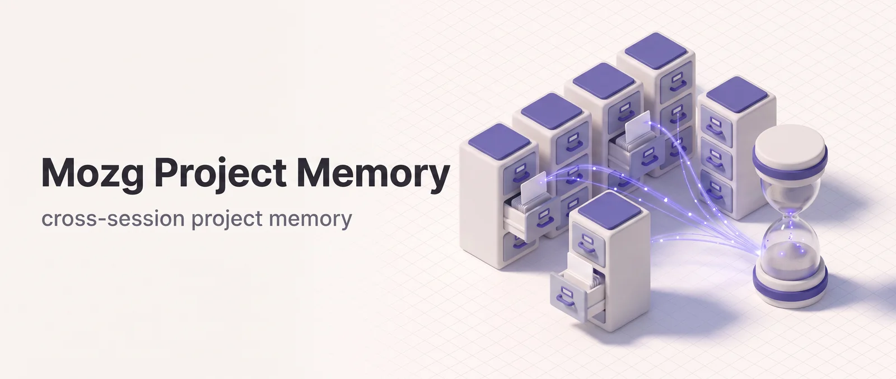

<p align="center"></p>

# mz-memory

Cross-session project memory for [Claude Code](https://claude.com/claude-code). It persists knowledge across sessions, re-injects it after `/clear` and compaction, and injects the memory relevant to each prompt. It also keeps a store of lessons learned from review findings, failures and your corrections, which you can promote into project rules. Two skills ship with it: `/memory-note` for manual notes and lessons, and `/lessons-promote` for turning recurring lessons into rules.

## Install

```bash
claude plugin marketplace add DoctorMozg/claude-pipelines
claude plugin install mz-memory
```

Memory activates automatically on install — no configuration needed. Background curation calls `claude -p` on your account; see [Background `claude -p` Runs](#background-claude--p-runs) to turn it off.

## How It Works

### Hook Lifecycle

| Hook                | Event                                | What it does                                                                                                                               |
| ------------------- | ------------------------------------ | ------------------------------------------------------------------------------------------------------------------------------------------ |
| **Memory inject**   | SessionStart (startup/clear/compact) | Injects Pinned, the top lessons, the Digest and the newest Activity Log lines                                                              |
| **Memory capture**  | SessionEnd                           | Logs each completed task once with its Decisions and Notes, collects every task's `## Lessons`, starts background curation and compression |
| **Memory prompt**   | UserPromptSubmit                     | Injects Pinned plus the lessons and entries matching the prompt's keywords; reminds Claude to save a lesson after a correction             |
| **Journal capture** | PostToolUse `AskUserQuestion`        | Appends the question and answer of every completed AskUserQuestion call verbatim to `.mz/journal.md` (needs `jq`)                          |

Memory is injected on a fresh start, after `/clear`, and after compaction, within 8,000 characters in all. Resume and fork are skipped because the reused transcript already holds it.

### Storage

Memory is stored at `.mz/memory/MEMORY.md` in the project root:

```
## Pinned
<!-- mz-pinned-start -->
- [2026-05-05] always run migrations forward-compatible
<!-- mz-pinned-end -->

## Digest
<!-- mz-digest-start -->
- [D-0003] n=2 last=2026-10-30 trig=log src=2026_10_12_build_auth tags=auth :: Sessions expire after 30 min; refresh tokens rotate on use
<!-- mz-digest-end -->

## Activity Log
<!-- mz-log-start -->
- [2026-05-05] task_name (phase=done) [branch@sha]
  Decision lines pulled from state.md
<!-- mz-log-end -->
```

- **Pinned**: persistent invariants and decisions. Never auto-pruned. Edit by hand or use `/memory-note`.
- **Digest**: what background compression distilled from old Activity Log entries, at most 40 items. It appears once the log first passes 300 lines.
- **Activity Log**: most recent first, capped at 400 lines and filled by SessionEnd. SessionStart injects only the newest 200 lines.

The file is human-readable and resilient to header corruption: the marker comments anchor every insert, so the structure repairs itself if a heading is hand-edited. `.mz/` stays out of git only if something excludes it. init-rules adds it to `.git/info/exclude`, or the project's `.gitignore` may list it. A team that wants the memory tracked runs `git add -f .mz/memory/MEMORY.md`.

### Project Root Detection

`mz-memory` walks up from `CLAUDE_PROJECT_DIR` (or the current working directory) to the nearest `.git`, so a single `MEMORY.md` is shared across every subdirectory of a monorepo. Override with `MZ_MEMORY_ROOT=/abs/path` if needed.

If your home directory is itself a git repository, such as a dotfiles checkout, every folder under it without a `.git` of its own resolves to home, and all of them share `~/.mz/memory/MEMORY.md`. Run `git init` in the folder, or set `MZ_MEMORY_ROOT` for it. `GIT_CEILING_DIRECTORIES` doesn't help: the hooks look for `.git` themselves and ignore it, while skills resolve the root with `git rev-parse`, which honors it, so setting it splits the two.

### What Gets Captured Automatically

- Completed task names and dates (from `.mz/task/*/state.md` where `Status: complete`; the legacy `completed` is also accepted)
- Each completion is logged once: only `state.md` files changed since the previous capture (tracked by the `.mz/memory/.last-capture` marker) are read, so editing a finished task's `state.md` logs it again. The first capture after an upgrade reads only the 50 most recently changed tasks to stay inside the SessionEnd time budget.
- Phase, current branch, and short SHA at session-end time
- The first 10 non-blank lines of `## Decisions` and `## Notes`, counted together in file order, from tasks whose `Status` is `complete`
- Up to 10 bullets of each task's `## Lessons`, whatever its `Status`, which go to the lessons Inbox (see [Lessons](#lessons))
- Per-agent routing: if the state file mentions `[agent-name]` for any agent under `.claude/agent-memory/<agent-name>/`, the entry is also appended to that agent's `MEMORY.md`

### Privacy

Wrap sensitive substrings with `<private>...</private>` tags in your task state files, note bodies or lessons. The capture and `/memory-note` paths strip these regions before persisting; surrounding whitespace is collapsed.

## Lessons

A lesson is one line saying what to do differently next time: `WHEN <situation> → <what to do> — WHY <cause>`. Lessons live in `.mz/memory/lessons.md`, apart from the Activity Log, so they don't roll off with it.

### Where Lessons Come From

- **Skill runs.** A skill that keeps `state.md` adds a line under `## Lessons` when a review finding is accepted and fixed, a step fails, gate feedback corrects a mistake, or an approved approach is reversed. SessionEnd collects them from every task, finished or not, since failed and blocked runs teach the most. A lesson already collected from the same task is skipped, so re-reading an edited `state.md` adds only its new lines; the same lesson from another task counts as a recurrence.
- **Your corrections.** When a prompt reads like a correction ("no, …", "you broke …", "that's not what I asked"), the prompt hook reminds Claude to fix the mistake and save the lesson with `/memory-note --lesson`. The check covers English phrasing only and the first 500 characters of the prompt, and it skips slash commands.

### The Lessons File

```
## Lessons
<!-- mz-lessons-start -->
- [L-0042] n=3 last=2026-10-30 trig=review src=2026_10_28_build_retry@abc1234 tags=hooks,jq :: WHEN a hook emits JSON → build it with jq -n — WHY printf broke on quotes
<!-- mz-lessons-end -->

## Inbox
<!-- mz-inbox-start -->
- [I-0107] 2026-11-02 trig=failure src=2026_11_02_debug_capture@9f01c2e status=failed :: WHEN … → … — WHY …
<!-- mz-inbox-end -->
```

New lessons wait in the **Inbox**. The **Lessons** section holds the curated ones, each with a count `n` of how often it was seen. The file stays under 500 lines. Past that, lessons seen fewer than 3 times move to `lessons.archive.md`, lowest count and oldest first, then the oldest Inbox items, until it is back at 480. Nothing is ever deleted: merged, superseded, dropped, evicted and promoted lessons all go to the archive verbatim.

### Curation

At SessionEnd, once 5 new items have reached the Inbox since the last run, or the file passes 450 lines with at least one new item, a background curator reads the file. It answers with operations by id, and the code applies them:

| Operation | Effect                                                                         |
| --------- | ------------------------------------------------------------------------------ |
| ADD       | Inbox items become a new curated lesson                                        |
| MERGE     | Inbox items repeat a curated lesson: its `n` grows and `last` becomes today    |
| SUPERSEDE | Inbox items show a curated lesson is wrong; the old one is archived            |
| DROP      | One-off or vague Inbox items are archived with a reason                        |
| COMBINE   | Two or more curated lessons saying the same thing become one, their `n` summed |

A run applies at most 30 operations and removes at most 10 curated lessons. It aborts if the curated count would shrink by more than 20% (and more than 2), and unknown ids are rejected. The result is applied under a lock against the file as it is then, so lessons added while the model was thinking survive. Every applied or rejected operation is logged to `lessons.ops.jsonl`. Without the curator, only the 500-line eviction runs.

### How Lessons Reach Claude

- **SessionStart**: the 12 curated lessons seen most often (then most recently), plus the 3 newest Inbox items, within 3,000 characters. They open with a line saying lessons are advice that never overrides the user.
- **Each prompt**: up to 5 lessons whose text or tags match the prompt's keywords, within 1,500 characters, ranked by how many keywords they hold, then by `n`.
- **Promotion hint**: when curated lessons reach `n` ≥ 3, SessionStart names them and asks Claude to offer `/lessons-promote` at a natural pause.

## Selective Injection on UserPromptSubmit

Each prompt is tokenized into keywords: lowercase ASCII letters and digits, at least 4 characters, common stopwords dropped, at most 12. The payload holds Pinned, the matching lessons, and up to 15 matching entries from the Digest and the Activity Log (Digest first), within 4,000 characters. Pinned comes with every prompt that yields keywords, even when nothing matches; a prompt that yields none and isn't a correction gets no payload.

A prompt written entirely in another script, such as Cyrillic, yields no keywords, so it gets no prompt-time injection at all, Pinned included, and the English-only correction reminder can't fire on it. SessionStart injection is unaffected.

## Activity Log Compression

When the Activity Log passes 300 lines, SessionEnd detaches `memory-compress.sh`. It keeps the newest 100 lines verbatim, extended to the end of the entry the cut lands in. The curator distills the older entries into the **Digest**, at most 40 items of 300 characters each. Those raw entries move to `activity.archive.md`, and the operations are logged to `activity.ops.jsonl`. A failed run changes nothing and retries the next day. Because compression starts below the 400-line cap, old entries are distilled instead of pruned. A summary block left by older versions (`<!-- mz-compressed -->`) is converted into Digest items once, without a model call.

## Background `claude -p` Runs

Lessons curation and Activity Log compression each run as a detached headless `claude -p` session, **on your own account**, so they use your plan or API usage. Each run:

- uses Sonnet unless `MZ_MEMORY_CURATOR_MODEL` names another model;
- stops after 180 seconds or $0.50, whichever comes first;
- has no tools, no hooks, no MCP servers and no slash commands, and starts in an empty temporary directory, so your project's CLAUDE.md never reaches it;
- treats lesson and log text as data, never as instructions;
- needs `claude` and `jq` on PATH, and is skipped without them.

Set `MZ_MEMORY_COMPRESS=0` to turn off both. The Activity Log is then pruned at 400 lines, and `lessons.md` is held at 500 lines by eviction alone. Failures are silent: neither run ever blocks a session.

## Interaction Journal

Alongside curated memory, `mz-memory` records a raw **interaction journal** at `.mz/journal.md` — one global, append-only log of AskUserQuestion calls, plus the entries skills add. Where `MEMORY.md` is the distilled recall store, the journal is the verbatim record of how agents and the user negotiated each step.

A `PostToolUse` hook matched to `AskUserQuestion` captures each completed AskUserQuestion call — question and answer, verbatim — so the trail survives even when context is compacted and the model forgets it is mid-gate. The hook redacts `<private>…</private>` regions to `[redacted]` before writing, with code formatting preserved. Skills append their own entries (skill, task, phase, the artifact under review) with a direct `>>` to `<root>/.mz/journal.md`; that bypasses the redactor, so they write sensitive values as `[redacted]` themselves. Questions asked in prose aren't captured.

Decisions reach memory from `state.md`, not from the journal: write a `## Decisions` section into the task's `state.md` and, once its `Status` is `complete`, the SessionEnd capture lifts it into the Activity Log and thus into the next session's injected context. The journal itself is disposable scratch; the memory store is what persists.

The entry format, the two-layer (hook + skill) capture model, and the redaction convention are specified in [`guidelines/JOURNAL_GUIDELINES.md`](../../guidelines/JOURNAL_GUIDELINES.md).

## Manual Notes and Lessons: `/memory-note`

```
/memory-note always run migrations forward-compatible
/memory-note --log ad-hoc activity entry
/memory-note --lesson WHEN a hook emits JSON → build it with jq -n — WHY printf broke on quotes
```

A note goes to **Pinned** by default, or to the **Activity Log** with `--log`, after an approval gate — no surprise edits to project memory. A note over 500 characters goes back to you to shorten.

`--lesson` adds one line to the lessons **Inbox** without a gate, because the curator reviews the Inbox later. Claude uses it after you correct it, writing the lesson from the correction. The lesson is filed as a correction unless it starts with `(review)`, `(failure)` or `(change)`. A lesson over 400 characters is refused, and the same text is saved only once a day. A typo you fixed in passing needs only the fix.

## Promoting Lessons: `/lessons-promote`

```
/lessons-promote
/lessons-promote L-0042 L-0017
```

Turns lessons into rules that every session loads in full. Without ids it takes the curated lessons seen at least 3 times, at most 5 per run. Each lesson gets its own Approve/Reject gate with a proposed rule and target:

- `.claude/rules/<topic>.md` with `paths:` globs when the lesson is about particular files, so the rule loads only when Claude works on them;
- the project's `CLAUDE.md` when it holds everywhere.

It never edits the blocks init-rules manages. An approved lesson moves to `lessons.archive.md` as `promoted_to=<target>`. A rejected one is recorded in `.mz/memory/.promote-declined`, and neither the hint nor the default list offers it again until it recurs.

## Environment Variables

| Variable                  | Effect                                                                      |
| ------------------------- | --------------------------------------------------------------------------- |
| `MZ_MEMORY_ROOT`          | Override project-root detection (absolute path)                             |
| `MZ_MEMORY_COMPRESS=0`    | Turn off both background `claude -p` runs: compression and lessons curation |
| `MZ_MEMORY_CURATOR_MODEL` | Model for those runs (default `sonnet`)                                     |

## Pair With

- **mz-dev-pipe**: Pipeline agents (planner, coder) have `memory: project` for agent-specific persistent memory; the per-agent bridge in `memory-capture.sh` automatically routes tagged task entries into their files
- **mz-base**: `init-rules` installs curated rule packs into `.claude/rules/`; `/lessons-promote` adds the project's own lessons alongside them

## Per-Agent Native Memory

`mz-dev-pipe` agents declare `memory: project` in their agent frontmatter. Claude Code honors this declaration by giving each agent a project-scoped `MEMORY.md` at `.claude/agent-memory/<agent-name>/MEMORY.md`. Each persona gets its own independent memory file that persists across sessions.

This is **complementary** to the global memory system this plugin provides:

- **Global memory** (`mz-memory`) lives at `.mz/memory/MEMORY.md` and is shared across every session and every agent. It is the place for project-wide facts, decisions, and completed task summaries.
- **Per-agent memory** (`memory: project` frontmatter) lives at `.claude/agent-memory/<agent-name>/MEMORY.md` and is scoped to a single persona.
- **Bridged**: when a task's `state.md` contains `[agent-name]` for any agent under `.claude/agent-memory/`, the SessionEnd capture writes the entry to both the global log AND that agent's file, closing the loop between the two layers.

## File Reference

| File                                     | Purpose                                                                                                 |
| ---------------------------------------- | ------------------------------------------------------------------------------------------------------- |
| `.mz/memory/MEMORY.md`                   | Project memory store: Pinned, Digest and Activity Log                                                   |
| `.mz/memory/activity.archive.md`         | Activity Log entries the Digest replaced, verbatim                                                      |
| `.mz/memory/activity.ops.jsonl`          | Operations each compression run applied or rejected                                                     |
| `.mz/memory/lessons.md`                  | Curated lessons and the Inbox, at most 500 lines                                                        |
| `.mz/memory/lessons.archive.md`          | Merged, superseded, dropped, evicted and promoted lessons, verbatim                                     |
| `.mz/memory/lessons.ops.jsonl`           | Curator operations, promotions and declines (newest 1,000)                                              |
| `.mz/memory/.lessons-seen`               | Keys of lessons already collected per task (newest 2,000)                                               |
| `.mz/memory/.lessons-curated`            | Highest Inbox id the last curation saw                                                                  |
| `.mz/memory/.promote-declined`           | Lessons declined for promotion, with their count at the time                                            |
| `.mz/memory/.compress-failed`            | Date of a failed compression, which waits for the next day                                              |
| `.mz/memory/.compress.lock`              | Lock directory held by a running compression                                                            |
| `.mz/memory/.curate.lock`                | Lock directory held by a running curation                                                               |
| `.mz/memory/*.bak`                       | Copy of `MEMORY.md` or `lessons.md` taken before a background run rewrites it                           |
| `.mz/memory/.last-capture`               | Marker whose mtime records the previous SessionEnd capture                                              |
| `.mz/journal.md`                         | Append-only interaction journal (AskUserQuestion calls and skill entries)                               |
| `.claude/agent-memory/<agent>/MEMORY.md` | Per-agent native memory (managed by Claude Code, bridged on capture)                                    |
| `scripts/lib/common.sh`                  | Shared helpers: `find_project_root`, `strip_private`, `atomic_write`, the MEMORY.md regions, …          |
| `scripts/lib/lessons.sh`                 | The lessons store: Inbox writes, ranking, matching, promotion candidates                                |
| `scripts/lib/curator.sh`                 | The shared curator: `claude -p` call, operations, guards, eviction                                      |
| `scripts/memory-{inject,capture}.sh`     | Core SessionStart / SessionEnd hooks                                                                    |
| `scripts/memory-prompt-inject.sh`        | UserPromptSubmit selective injection and correction reminder                                            |
| `scripts/memory-compress.sh`             | Background Activity Log compression into the Digest                                                     |
| `scripts/lessons-curate.sh`              | Background lessons curation                                                                             |
| `scripts/journal-capture.sh`             | PostToolUse(AskUserQuestion) hook — records completed calls to `.mz/journal.md`                         |
| `scripts/journal-append.sh`              | Internal helper used by journal-capture.sh (flock-guarded, `<private>`-redacting); skills don't call it |
| `scripts/memory-note.sh`                 | CLI helper invoked by the `/memory-note` skill                                                          |
| `scripts/lessons-promote.sh`             | CLI helper invoked by the `/lessons-promote` skill: list, archive, decline                              |
| `skills/memory-note/SKILL.md`            | Notes with an approval gate; lessons straight to the Inbox                                              |
| `skills/lessons-promote/SKILL.md`        | Promotes lessons into CLAUDE.md or `.claude/rules/`, one gate per lesson                                |
