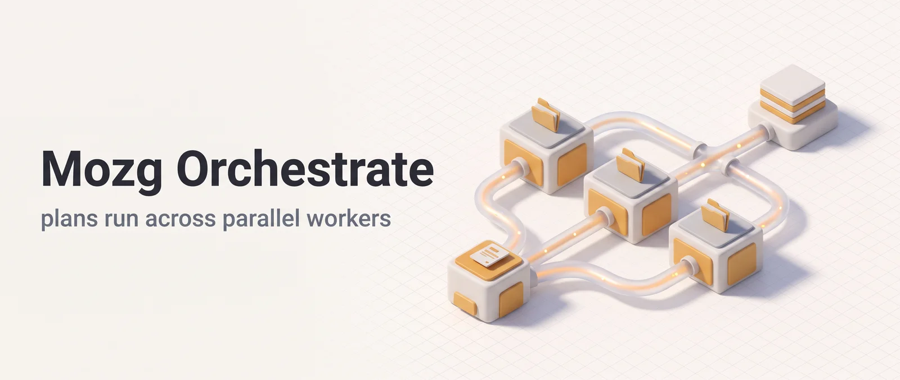
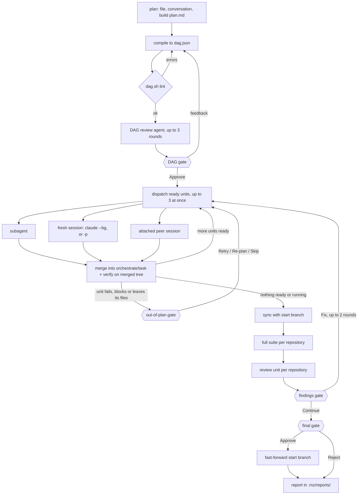

<p align="center"></p>

# Mozg Orchestrate (`mz-orchestrate`)

Runs a plan you have already settled as parallel units on workers, each unit in its own git worktree. Plan the work wherever you like: with `/orchestrate-plan`, in a conversation, with `/govern`, with `/build`'s planner, in an ADR or a design doc. Then hand the plan to `/orchestrate`. It splits the plan into units with dependencies, asks you to approve that split once, and runs the units through the mozg skill that fits each one (`build`, `debug`, `polish`, `document`, or a review). As each unit finishes, it is merged into an integration branch and verified, and every unit it unblocked starts. After the DAG gate you are asked only when something leaves the plan, when the final review finds something to fix, and at the final gate.

It is for plans with at least a few units that don't touch the same files. For one small change, run `/build` or `/debug` directly: orchestration adds a compile, a DAG review and a gate.

## Install

```bash
claude plugin marketplace add DoctorMozg/claude-pipelines
claude plugin install mz-orchestrate
```

Worker mode needs mz-dev-pipe (and mz-creative for documentation units) installed in every session that runs units.

## Quick start

1. Settle a plan. A markdown file is enough:

   ```markdown
   # Invoices

   1. Add the `Invoice` model and migration (`app/models/`, `migrations/`).
   1. Add `POST /invoices` (`app/api/`). Needs the model.
   1. Document the endpoint in `docs/api.md`. Needs the endpoint.
   1. Fix the rounding bug in `app/billing/tax.py` (see issue 212). Independent of the rest.
   ```

1. Run `/orchestrate PLAN.md`. The plan can also be `task:<task_name>` (an `/orchestrate-plan` task, or the `plan.md` of an earlier `/build` run), or nothing at all, which takes the plan in the current conversation.

1. Read the DAG gate. It shows the unit graph, and for each unit its skill, backend, owned paths, verify command, dependencies and full spec. Answer **Approve**, **Reject**, or type feedback and the DAG is recompiled.

1. Wait. Units 1 and 4 start together. Unit 2 starts when 1 is merged, and unit 3 when 2 is merged.

1. Answer the gates that come up, if any, then the final gate. On **Approve**, your branch is fast-forwarded to `orchestrate/<task>`. The report is at `.mz/reports/<task>.md`.

## Planning with `/orchestrate-plan`

With a goal but no plan yet, `/orchestrate-plan <goal>` writes one that is ready to run:

```text
/orchestrate-plan add invoices: model, POST /invoices, docs, and fix the tax rounding bug
```

1. **Interview.** It asks up to 4 questions about whatever the goal and the code leave open: scope, what "done" means, hard limits, which repositories. A clear goal gets no questions.
1. **Research.** Up to 4 `pipeline-researcher` agents map the code each part of the goal touches, one per repository or major area: files, conventions, test commands and the shared files several changes would edit.
1. **Plan.** `orchestrate-planner` (opus) writes the plan document to `.mz/design/<task>.md` (goal, scope, decisions with their reasons, risks, open questions) and the units to `dag.json`. `dag.sh lint` checks it, and `orchestrate-dag-reviewer` reviews it for up to 3 rounds.
1. **Plan gate.** You see the plan, the unit graph and every unit's spec, owned paths and verify command. **Approve**, **Reject**, or type feedback and the planner revises.
1. **Run.** On Approve it starts `/orchestrate task:<task>`. That approval counts as the DAG gate: `/orchestrate` checks that `dag.json` still has the approved hash and lints it against the sessions attached now, then starts the units. If the DAG changed or no longer lints, `/orchestrate` reviews it and shows its own DAG gate.

Planning costs a few researchers, one opus planner and up to 3 sonnet reviews, roughly $2-4. With `MZ_DEV_PIPE_AUTO_APPROVE=1` it asks nothing: open points become assumptions listed in the plan, the gate is approved and logged, and the run that follows never lands on your branch.

## Flow



A script, not the model, computes ready sets, lint results and unit statuses (`scripts/dag.sh`), and does every git step on the integration and unit branches (`scripts/integrate.sh`).

## Skills

| Skill                 | What it does                                                                                                                                                                                                                                           |
| --------------------- | ------------------------------------------------------------------------------------------------------------------------------------------------------------------------------------------------------------------------------------------------------ |
| `/orchestrate`        | Compiles a plan (a conversation, any markdown file, a build `plan.md`, an ADR or a design doc) into a DAG of units with owned paths, dependencies, a skill and a verify command each. A script lints it, an agent reviews it, and you approve it once. |
| `/orchestrate-plan`   | Plans a goal for `/orchestrate`: an interview, parallel codebase research, a plan document and a reviewed `dag.json`, approved at one gate, then starts the run.                                                                                       |
| `/orchestrate-attach` | Lists the other Claude sessions on this machine, and the ones you pick become workers, each with a purpose such as "only UI in the web repo" or "only for review".                                                                                     |
| `/orchestrate-detach` | Releases attached sessions. A session running a unit can finish it, hand it to another worker, or cancel it.                                                                                                                                           |
| `orchestrate-worker`  | Not typed by hand. Attached sessions and started workers run it when an orchestrator's message arrives.                                                                                                                                                |

`/orchestrate` takes `<plan file>`, `task:<task_name>`, `this plan`, or `resume [<task_name>]`.

## What a unit is

The compiler turns the plan into `dag.json`. Each unit is one piece of work a single `build` or `debug` run finishes well: about 10 files and 400 changed lines at most.

```json
{
  "id": "WU-2",
  "title": "Invoice API endpoint",
  "kind": "change",
  "repo": "/home/me/work/app",
  "skill": "mz-dev-pipe:build",
  "spec": "## Goal\nAdd `POST /invoices` ...\n\n## Given by WU-1\n`Invoice` model in `app/models/invoice.py` ...\n\n## Acceptance\n- 201 with the invoice id ...\n\n## Out of scope\nPDF rendering (WU-4).",
  "owns": ["app/api/invoices.py", "app/api/__init__.py", "tests/api/test_invoices.py"],
  "depends_on": ["WU-1"],
  "verify": "uv run pytest tests/api/test_invoices.py -q",
  "backend": "auto",
  "status": "pending"
}
```

- `kind` is `change` (commits on its own branch) or `review` (read-only, returns findings, and `owns` is `[]`).
- `spec` is all the worker sees. It never reads the plan, so the spec carries the goal, binding decisions, interfaces from dependencies, acceptance criteria and what is out of scope. When the plan left a choice open, the spec tells the worker to stop with `STATUS: BLOCKED` before writing code.
- `owns` lists every path the unit may create or change, tests and shared files included. Two units that can run at the same time may not own overlapping paths in one repository. `dag.sh lint` rejects that, and the fix is a dependency edge or a split.
- `skill` is chosen by intent and only from the skills installed in your session: new behavior is `mz-dev-pipe:build`, a defect with a reproduction is `mz-dev-pipe:debug`, cleanup or getting tests green is `mz-dev-pipe:polish`, documentation is `mz-creative:document`, a read-only check is `mz-dev-git:review-branch` or `mz-dev-pipe:audit`, and a mechanical edit of a few lines is `direct`. With none of the change skills installed, every change unit becomes `direct`.
- `verify` is a non-interactive command that proves the unit, using the repository's own test runner. It runs in the unit's worktree and again on the merged tree before the unit counts as merged. A `review` unit uses `true`.
- `status` is written only by `dag.sh`: `pending`, `running`, `done`, `merged`, `blocked`, `failed` or `skipped`.

The full field list and the rules for a good unit are in `skills/orchestrate/references/dag-schema.md`.

## Backends

| `backend`   | Where the unit runs                                                                                                                                                                                    |
| ----------- | ------------------------------------------------------------------------------------------------------------------------------------------------------------------------------------------------------ |
| `subagent`  | An `orchestrate-unit-runner` subagent of the orchestrating session, in its own worktree. Works only in the project repository.                                                                         |
| `session`   | A fresh session in the unit's repository, in worktree `orch-<task>-<id>`, in auto mode with no permission prompts. It's a `claude --bg` session when you trust that repository, otherwise `claude -p`. |
| `peer:name` | A session you attached with `/orchestrate-attach`. Needs a peer whose role covers the unit.                                                                                                            |
| `auto`      | Resolved when the unit is dispatched: the first attached peer whose role fits and that is idle, else a subagent when `repo` is the project, else a fresh session.                                      |

The compiler leaves `backend` at `auto` unless the plan or you name one. Subagents and fresh sessions together take at most 3 slots (`MAX_WORKERS`), because each worker runs a skill that dispatches about 6 agents of its own. Each peer runs one unit at a time, outside that limit.

A fresh `--bg` session shows up in `claude agents` under the name `orch-<task>-<id>`. You can watch it with `claude attach orch-<task>-<id>`, and it messages its result back to the orchestrator. Claude Code refuses `--bg` in a repository you haven't trusted (open `claude` there once and accept the prompt), and then the unit runs as `claude -p`. A fresh session's permissions are its own: a step its auto-mode classifier denies ends the unit as `FAILED` or `BLOCKED` instead of asking you.

## Attaching sessions

Attach sessions you already have open, for example one in another repository or one reserved for review.

```text
/orchestrate-attach
/orchestrate-attach web-session "only UI in the web repo"
/orchestrate-attach reviewer "only for review"
```

With no arguments, the skill lists the other sessions on this machine and asks which to attach and what each is for. The three stock purposes are **Any unit**, **Review only** and **Only its own repo**. **Other** takes free text such as "only UI in the web repo".

The purpose becomes a role filter with four lists (`kinds`, `repos`, `paths`, `skills`, each a list or `any`) and a `note` holding your words verbatim. A unit fits a role when every non-`any` list matches: its `kind` is in `kinds`, its `repo` is in `repos`, every `owns` glob falls under one of `paths`, and its `skill` is in `skills`. For example, "only UI in the web repo" maps to that repository and a `web/**` path glob, and "only for review" maps to `kinds: ["review"]`. Anything that doesn't map to a field stays in `note`, which the compiler reads when it routes units. The orchestrator checks the fit before sending a unit, and the peer checks it again on receipt and replies `REFUSED` to a misfit.

Each chosen session gets an `ORCH-ATTACH` message and answers with its working directory, repository, branch and installed skills. From then on it runs units the orchestrator sends **without asking you**, within its own permission settings. It accepts messages only from the session that attached it, identified by the socket address the harness stamps on each message, and only units that fit its purpose. Change a purpose with `/orchestrate-attach <name> "<new purpose>"`.

A session must accept messages from other sessions (`crossSessionInbound: accept` in its settings) to be attached. Sessions that hold or refuse them are reported and get no units. A session without `orchestrate-worker` (mz-orchestrate installed there) is reported as unable to run units.

`/orchestrate-detach` releases sessions. A session that is running a unit gets a choice: **Wait** (detach after its result is merged), **Reassign** (cancel here and let `/orchestrate` send the unit elsewhere) or **Cancel** (cancel and send the unit to the out-of-plan gate). A peer reads messages only between turns, so a cancel takes effect once its current unit returns.

## Gates

| Gate        | When                                                                                                               | Options                                                                     |
| ----------- | ------------------------------------------------------------------------------------------------------------------ | --------------------------------------------------------------------------- |
| DAG         | Once, after compile and review                                                                                     | **Approve**, **Reject**. Any other reply is feedback and recompiles         |
| Out of plan | A unit fails twice, is blocked, refused, leaves its `owns`, conflicts, goes red after merge or passes its deadline | **Retry** (type guidance to send with it), **Re-plan**, **Skip**, **Abort** |
| Findings    | The final review or suite found critical or major items                                                            | **Fix** (type which items to narrow it), **Continue**, **Stop**             |
| Final       | Last, per run                                                                                                      | **Approve**, **Reject**                                                     |

What the out-of-plan options do:

- **Retry** runs the unit again with your guidance appended to its spec.
- **Re-plan** has the compiler rewrite the unit and its dependents, keeping merged and done units. You see the change as a new DAG gate.
- **Skip** drops the unit and everything downstream.
- **Abort** dispatches nothing more, lets running units finish, and reports.

The findings gate offers **Fix** at most twice (`MAX_FINAL_ROUNDS`). In the second round it offers only **Continue** and **Stop**. **Stop** ends the run with nothing landed. At the final gate, **Approve** fast-forwards each start branch to its integration branch. **Reject** lands nothing and keeps the integration branches.

A missing answer, such as a denied prompt, is never approval: the run stops with `Status: blocked`.

## Unattended mode

With `MZ_DEV_PIPE_AUTO_APPROVE=1`, nobody is asked, and each gate picks the safe choice:

| Gate        | Auto choice                                                                                                                           |
| ----------- | ------------------------------------------------------------------------------------------------------------------------------------- |
| DAG         | Approved and logged.                                                                                                                  |
| Out of plan | The unit is skipped and marked `blocked` with its reason. Only its dependents are skipped, and the rest of the plan keeps running.    |
| Findings    | **Fix** in round 1, **Continue** after that.                                                                                          |
| Final       | The gate is shown, but nothing lands. `landed: no` is recorded and logged as not approved. Unattended mode never changes your branch. |

The integration branch `orchestrate/<task>` is left for you to review and merge.

## The final phase

When nothing is ready or running, each repository's integration branch is checked as a whole:

1. The start branch is merged into the integration branch, so the checks see what landing would produce. A conflict goes to the merge resolver. If that fails, the repository is listed with `sync: conflict`.
1. The full suite runs through the tooling detector and the test runner. A repository with no detected test command gets `suite: not-run`.
1. A review unit (`mz-dev-git:review-branch`) reads `git diff <start_branch>...HEAD` for each repository whose suite isn't red. It goes to a review-role peer when one fits. Findings are `critical`, `major` or `minor`, and `minor` findings are only reported.
1. Critical and major findings and failing tests are the open items. With none, the run goes to the final gate. Otherwise the findings gate asks. **Fix** adds at most one fix unit per repository (`mz-dev-pipe:debug` for failing tests and bugs, `mz-dev-pipe:polish` for the rest), runs them, and checks again.
1. The final gate lists, per repository, the start branch, the commits to land, the diffstat, the suite result, open items, and any units that ended `blocked`, `skipped` or `failed`.

Landing is `integrate.sh land`, a fast-forward: no merge commit in your checkout, nothing over uncommitted edits, never a push. If you committed during the gate, the sync and suite run once more, and green lands without asking again. If a checkout is on another branch or has uncommitted edits in the way, that repository is recorded as `landed: no` with the command for you to run. Nothing is forced.

The report at `.mz/reports/<task>.md` has the outcome per repository, the unit table, final checks per round, open items, concerns raised by workers, and the failed-attempt branches that were kept for inspection.

## Resume

```text
/orchestrate resume
/orchestrate resume 2026_11_22_orchestrate_invoices
```

Without a name, the newest orchestration under `.mz/task/` whose status is `running` or `blocked` is resumed. Resume reconciles first: an interrupted merge is aborted and redone, finished units whose result was never merged are merged, a unit whose worker committed before the restart is checked and merged rather than run again, and a unit with nothing left is re-queued without counting the lost attempt. Attached peers are re-attached, because their attachment names the old session's address. Nothing runs twice.

## Multi-repo runs

A plan can name other repositories. Each unit's `repo` is its repository, and each repository gets its own integration branch `orchestrate/<task>` and integration worktree. Units run on subagents only in the project repository, so units elsewhere go to a fresh session or a peer, which is how a review peer or a "web repo only" peer is useful. The suite, the review, the final gate section and the landing are per repository. A repository that isn't a git repository is reported and you are asked for its path.

## Background sessions

Started as `claude --bg`, `/orchestrate` has to move into its own worktree before it may write, so its task state and integration worktrees live under `.claude/worktrees/orchestrate-<slug>/` in that repository, and `/orchestrate resume` looks there too. The run still starts from the branch you were on. It never touches your checkout of that repository, so bringing the result into it is yours to do: `git merge --ff-only orchestrate/<task>`. Stopping the session keeps that worktree, but `claude rm <session>` deletes it, with the run's state and its integration worktrees, so land the run first. The `orchestrate/<task>` branches stay either way. Setting `"worktree": {"bgIsolation": "none"}` in `.claude/settings.json` turns that isolation off.

## Worker mode in other plugins

`build`, `debug` and `polish` (mz-dev-pipe) and `document` (mz-creative) take a `unit:<path>` argument, a brief written by the orchestrator. With it they answer their own approval gates on the strength of the orchestrator's approval, still run every phase and agent, never ask a question, keep their edits inside the unit's files, and end with a `STATUS:` line. A question they would have asked comes back to the orchestrator as `STATUS: BLOCKED`. The contract is in `shared/worker-mode.md`.

If a skill needs a file outside `owns`, it makes the smallest edit and reports it under `## Concerns`. A large edit stops with `STATUS: BLOCKED`. The worker, not the skill, commits the result: one commit per unit, staging only the `owns` paths.

## Limits and costs

| Limit             | Value      | Meaning                                                                                     |
| ----------------- | ---------- | ------------------------------------------------------------------------------------------- |
| Parallel workers  | 3          | Subagents plus fresh sessions at once. Peers are extra, one unit each                       |
| DAG review rounds | 3          | A DAG still failing review after three revisions is shown at the gate with its findings     |
| Auto retries      | 1          | A failed unit is retried once with the failure in its spec. A second failure goes to you    |
| Final rounds      | 2          | The final review runs at most twice, so one round of fixes is checked before the final gate |
| Unit deadline     | 45 minutes | A unit past it goes to the out-of-plan gate, and a silent peer gets one `ORCH-STATUS` first |

Rough cost per unit on small units, shown at the DAG gate: `build` about $2.50, `debug` about $1, `polish` about $0.50, a review about $1, `direct` about $0.20. Each `build`, `debug` and `polish` unit runs that skill's full pipeline of agents, so large units cost more. The final review adds one review unit per repository.

## Troubleshooting

**The DAG gate shows `Unresolved review findings`.** The reviewer still failed the DAG after 3 rounds. Reject, or reply with the fix you want (a missing `owns` path, a missing dependency edge) and it recompiles.

**Every unit is `direct`.** None of the change skills is in your session. Install mz-dev-pipe (and mz-creative for documentation) and run again.

**A unit lands at the out-of-plan gate with `edited outside owns`.** The worker changed files its `owns` doesn't list. Retry with guidance, or Re-plan so `owns` covers the shared file. The run records a `## Lessons` line in its state so later plans avoid the same gap.

**`red after merge` or `merge conflict`.** The unit passed alone but not on the merged tree, or the resolver couldn't reconcile two units. The merge is aborted and the integration branch stays clean. Retry with guidance, or Re-plan.

**A unit fails with an API error or a usage limit.** It goes straight to the out-of-plan gate, marked `failed` with the cause, without the automatic retry: re-dispatching doesn't fix an exhausted quota. Wait for the limit to reset, then Retry.

**`silent past deadline` on a peer.** The peer didn't answer an `ORCH-STATUS` after 45 minutes. Check that session. Retry sends the unit again.

**A peer replies `REFUSED: not attached`.** It lost its attachment, usually because the orchestrating session restarted. Re-attach with `/orchestrate-attach`. `/orchestrate resume` does this for you.

**A peer is reported as refused.** It holds or refuses cross-session messages. Set `crossSessionInbound` to `accept` in its settings and attach again.

**A unit is `blocked`.** The worker needed an answer it can't ask for, such as a decision the plan left open. The question and options are in the gate message. Answer with Retry and your guidance.

**Nothing landed, and the final gate says `land it yourself`.** The repository is a `--bg` worktree (see Background sessions). Run the printed `git merge --ff-only` command in your checkout.

**`integrate.sh` exits 1.** The run stops dispatching and prints the message. The integration worktree keeps whatever state the message names, and `/orchestrate resume` reconciles interrupted merges.

**A plan file is missing or the conversation holds no plan.** The skill asks for the path or the pasted plan. With nobody to ask, the run ends as `blocked`.

## Data and network

Messages between sessions travel over local Unix sockets that Claude Code manages. This plugin opens no network connections of its own and sends nothing off the machine. It writes `.mz/orchestrate/peers.json` (the attached sessions and their purposes) in the orchestrating project, `orchestrate-attachment.json` in each attached session's scratchpad directory, which is cleared with the session, task state under `.mz/task/`, the plan documents `/orchestrate-plan` writes under `.mz/design/`, and the run's report under `.mz/reports/`. The only change it makes to your own branch is the fast-forward you approve at the final gate. Worker worktrees live under each repository's `.claude/worktrees/`, and the integration worktrees under `.mz/worktrees/<task>/` in the orchestrating project. A fresh session is a `claude -p` run in auto mode with no permission prompts, so a step its classifier denies ends the unit as blocked instead of asking you. The plugin needs `jq` on `PATH`.

## Requirements

- Claude Code with cross-session messaging (v2.1.224 or later on macOS, Linux and WSL 2).
- mz-dev-pipe in every session that runs units, mz-creative for documentation units, and mz-dev-git for review units.
- `jq` on `PATH`.
