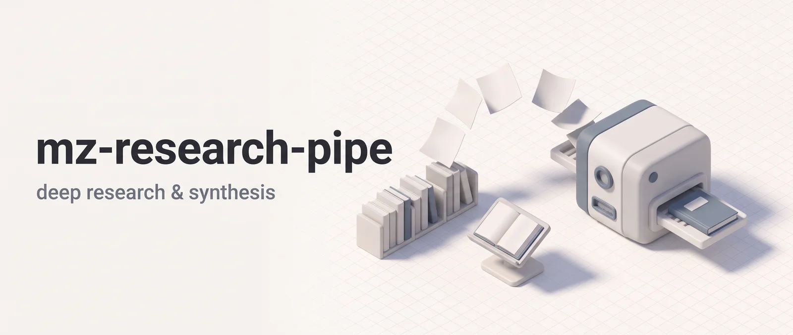

<p align="center"></p>

# mz-research-pipe

mz-research-pipe turns research and content work into files you can review: a sourced web research report, one synthesis of the reports and notes you already have, translated docs and i18n resources, or a diagram-rich explanation of existing code. It's for developers who want a briefing, a consolidated write-up, localized docs or a code walkthrough without leaving Claude Code. `/deep-research`, `/combine` and `/translate` show you a plan first and wait for your approval before the main work starts. `/explain` only reads code and writes a report.

**Works in:** Claude Code and Cowork. claude.ai chat loads skills without their agents, and all four skills here dispatch agents.

## Installation

```bash
claude plugin marketplace add DoctorMozg/claude-pipelines
claude plugin install mz-research-pipe
```

Installing it also pulls in its dependencies, mz-base and mz-dev-pipe, which supply the researcher agents the four skills dispatch. `pipeline-translator` ships in this plugin (see Agents below).

## Pick a skill in 5 seconds

| You want to                                   | Run              | Result                                             |
| --------------------------------------------- | ---------------- | -------------------------------------------------- |
| Research a topic across the web               | `/deep-research` | `.mz/research/<YYYY_MM_DD>_research_<slug>.md`     |
| Synthesize prior pipeline output into one doc | `/combine`       | `.mz/reports/<YYYY_MM_DD>_combine_<slug>.md`       |
| Translate files preserving structure          | `/translate`     | Translated files, `README.ru.md` style by default  |
| Understand existing code                      | `/explain`       | `.mz/reports/<YYYY_MM_DD>_explain_<scope_name>.md` |

In Claude Code the full form is `/mz-research-pipe:<skill>`, for example `/mz-research-pipe:deep-research`.

## Skills

### `/deep-research`: multi-agent web research

```
/deep-research best practices for gRPC error handling in Go
/deep-research comparison of vector databases for RAG pipelines
```

It splits the topic into 3 to 7 independent subtopics and shows you the list. Reply with feedback to revise it, or Reject to stop. After you approve, one `pipeline-web-researcher` per subtopic runs in parallel. Each is told to read at least 20 pages (target 100) across at least five distinct queries, prefer primary sources such as official docs and papers, cross-check key claims against two independent sources, and note contradictions.

The report has an executive summary, findings per subtopic with a confidence rating, cross-cutting themes, contradictions, research gaps, methodology and a deduplicated source list.

**Pipeline**: Decompose, user approval, parallel web research (one agent per subtopic), cross-reference synthesis, report

### `/combine`: local source combiner

```
/combine consolidate what we learned about the auth refactor
/combine sections:Context,Findings,Risks synthesize our findings on the WebSocket reconnection work
/combine output:docs/caching_summary.md pull together our notes on cache invalidation
```

It synthesizes what's already on disk (`.mz/research/`, `.mz/task/*/`, `.mz/reports/`, `.mz/reviews/`, codebase files and the last 50 commits) into one report. It lists the sources by name and age and proposes 3 to 6 lenses, each with an explicit file list. You approve or revise that plan before any file's contents are read.

Stale files are left out (task artifacts after 30 days, reports and reviews after 60, research after 90) unless the task is about history or the file name matches the task. One `pipeline-researcher` per lens extracts facts from its files and is told not to use the web. If the lenses leave gaps, one wave of up to six `pipeline-web-researcher` agents tries to fill them, and any gaps still open are listed in the report.

Report sections come from the task text, or verbatim and in order from `sections:`. Conflicts, Gaps, Sources and Methodology are always appended, plus Timeline when git history was used. An existing report is never overwritten. A `_v2` suffix is added instead. A task under five words, or one that says "everything", gets a clarifying question first. With too little on disk for three lenses, `/combine` offers a codebase-only run or abort. It does not turn into `/deep-research`.

**Pipeline**: Inventory, lens decomposition, user approval, parallel lens dispatch, synthesis, optional web gap-fill, task-adaptive report

### `/translate`: translation and localization

```
/translate README.md to Russian
/translate locales/en.json to fr mode:i18n
/translate docs/**/*.md to Japanese
/translate CHANGELOG.md to de mode:inplace
```

Give it a plain-language request: files or globs, a target language and an optional `mode:`. Supported formats are `md`, `mdx`, `json`, `yaml`/`yml`, `po`, `properties`, `strings`, `xliff` and `txt`. Binary formats such as `.docx` and `.pdf` aren't supported. The skill detects the source language (name it yourself with `from en` to skip detection), seeds a glossary from the source and shows a plan covering files, output paths, chunking, glossary summary and verification cost. Nothing is translated until you approve.

Then up to six `pipeline-translator` agents run in parallel. They swap placeholders for opaque tokens, translate, restore the tokens and check their own output. Files over 500 lines are split at headings, top-level keys or message units. Verification is always on, in three tiers:

1. Tier 1: structural checks inside the translator (placeholder counts, JSON and YAML keys, markdown fences, headings and tables, glossary terms).
1. Tier 2: an LLM-as-Judge review of every chunk, split into parallel batches.
1. Tier 3: Wiktionary, MyMemory and back-translation on flagged chunks only.

A chunk with a `Critical:` finding is re-translated, at most twice. Anything still unresolved is listed as a concern in the final summary.

**Pipeline**: Discovery, language detect, glossary seed, plan, user approval, parallel translation + Tier 1, cross-file consistency, Tier 2 judge, Tier 3 deep verify (flagged chunks only), re-translation loop, summary

**Output modes**:

- `sidecar` (default): writes a sibling file such as `README.ru.md`.
- `i18n`: rewrites the `locales/<lang>/…` or `i18n/<lang>/…` segment of the path, and falls back to `sidecar` for a file without one.
- `inplace`: overwrites the original. Destructive, so it needs a literal `mode:inplace`, and the plan flags it.

### `/explain`: code explainer

```
/explain src/auth/
/explain how does the payment flow work
/explain scope:branch
/explain output:docs/architecture.md the event bus module
```

It researches a scope across structure, execution flow and domain context, then writes a report on how the code works, why it's built that way and where it may break. It accepts a path or glob, a free-text question or both. With free text only, a `pipeline-researcher` first finds the matching files. Ignored, vendored, generated and lock files are skipped, as are files over 5,000 lines. Tests are included.

One to three `pipeline-researcher` agents do the work. Up to 10 files get one analyst. More than 10 get separate structure and flow analysts. A domain researcher is added when the code uses external libraries, services or protocols.

Every report has an architecture diagram and an execution-flow diagram in Mermaid, plus data-flow, sequence, class, ER, state or mindmap diagrams where they apply. Other sections are an overview (it leads with the answer if you asked a question), design decisions, external context, observations and an appendix. Each `file:line` reference is checked against the code before the report is written.

**Pipeline**: Scope resolution, parallel researchers (1 to 3), synthesis, report with diagrams

## Scope parameter

`/explain`, `/combine` and `/translate` accept the standard `scope:` parameter (`branch`, `global` or `working`) to limit which files agents work on.

| Mode            | What it includes                                         |
| --------------- | -------------------------------------------------------- |
| `scope:branch`  | Files changed on this branch vs base                     |
| `scope:global`  | All source files (minus vendored, generated, lock files) |
| `scope:working` | Uncommitted changes (staged + unstaged + untracked)      |

Per skill:

- `/combine`: narrows only the codebase lens. Reports, research and task artifacts under `.mz/` stay eligible whatever the scope.
- `/explain`: `scope:global` needs a focusing question, and the skill asks for one if you give none.
- `/translate`: paths you name define the scope. With no path it defaults to `global`.

## Agents

| Agent                       | Ships in    | Used by                                                                   | What it does                                                                                                                                                                                |
| --------------------------- | ----------- | ------------------------------------------------------------------------- | ------------------------------------------------------------------------------------------------------------------------------------------------------------------------------------------- |
| **pipeline-translator**     | this plugin | `/translate`                                                              | Translates one file or chunk, keeping markdown structure, code fences and placeholders intact. Runs Tier-1 checks and reports its own confidence.                                           |
| **pipeline-web-researcher** | mz-base     | `/deep-research` (one per subtopic), `/combine` (gap-fill)                | Searches and reads web pages, cites sources and rates confidence per finding. Read-only.                                                                                                    |
| **pipeline-researcher**     | mz-base     | `/combine` (one per lens), `/explain`, `/translate` (discovery, glossary) | Reads code and files and returns findings in its reply. Read-only. It can also search the web.                                                                                              |
| **pipeline-code-reviewer**  | mz-dev-pipe | `/translate` (Tier-2 judge)                                               | Reviews translated chunks for meaning, glossary use, placeholder parity, structure and natural phrasing. Labels findings `Critical:`, `Nit:`, `Optional:` or `FYI:`. No Write or Edit tool. |

`pipeline-translator`, `pipeline-researcher` and `pipeline-code-reviewer` are pipeline-only: their definitions say skills dispatch them, not your own session.

## Data and network

**Local files.** Reports and task state live under `.mz/` in the project root (the git root, or `MZ_MEMORY_ROOT` if set). Nothing uploads them.

- `/explain` reads the files in scope and runs read-only `git` commands to resolve `scope:`. It changes no source file and has no approval step. Working files go to `.mz/task/<task_name>/` and the report to `.mz/reports/`, or to your `output:` path.
- `/combine` reads existing reports and notes under `.mz/`, codebase files, `git log --oneline -50` and `git status --short`. Until you approve the lens plan it reads only file names, ages, and git's commit list and status. The lens agents read the files themselves afterwards. Working files go to `.mz/task/<task_name>/` and the one new report to `.mz/reports/` or your `output:` path.
- `/translate` writes translated files only after you approve the plan, so rejecting it writes none. Before that it writes only working files (state, file table, glossary, plan) to `.mz/task/<task_name>/`. After approval the translators write to the planned paths: beside the source in `sidecar` mode, under the target locale in `i18n` mode, or over the original in `inplace` mode. A target file that already exists is flagged in the plan. `pipeline-translator` also keeps project memory (terminology and style notes, not file contents) in `.claude/agent-memory/pipeline-translator/MEMORY.md`.
- `/deep-research` writes working files to `.mz/task/<task_name>/` before approval and the report to `.mz/research/` after it. Its researchers are read-only.

**Network.** The skills use Claude Code's WebSearch and WebFetch tools:

- `/deep-research`: every researcher searches the web. Queries come from your topic and its subtopics.
- `/combine`: only the optional gap-fill wave goes online, with queries drawn from the gaps your local sources left. Lens agents are told not to use the web. Your approval covers the inventory and lens plan. The gap-fill wave starts after synthesis without a second prompt.
- `/explain`: only the domain researcher is asked to go online, when the code uses external libraries, services or protocols. Names of dependencies from your code can appear in its queries.
- `/translate`: language detection uses no third-party service. It tries a Unicode-script check, then a Claude agent, then asks you. After approval, flagged chunks are spot-checked against Wiktionary (single words, up to 10 lookups per run) and MyMemory (sentences from your files, up to 9 queries per run). The plan shows this budget before you approve it.
- As in any Claude Code session, your prompts and the files Claude reads go to the model you use, under your own account.

**Hooks and the author.** mz-research-pipe has no hooks of its own, and its `shared/` folder holds markdown rule files the skills read. Its dependencies mz-dev-pipe and mz-base have no hooks either. Nothing is sent to the author: no telemetry, analytics or crash reports.

## Support

- Issues: <https://github.com/DoctorMozg/claude-pipelines/issues>
- Email: drmozg@gmail.com
- Privacy: [PRIVACY.md](https://github.com/DoctorMozg/claude-pipelines/blob/master/PRIVACY.md) lists what stays on your machine and what each plugin sends out.

## License

MIT
